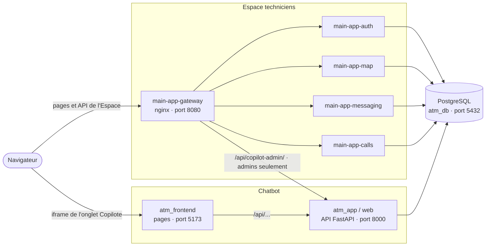
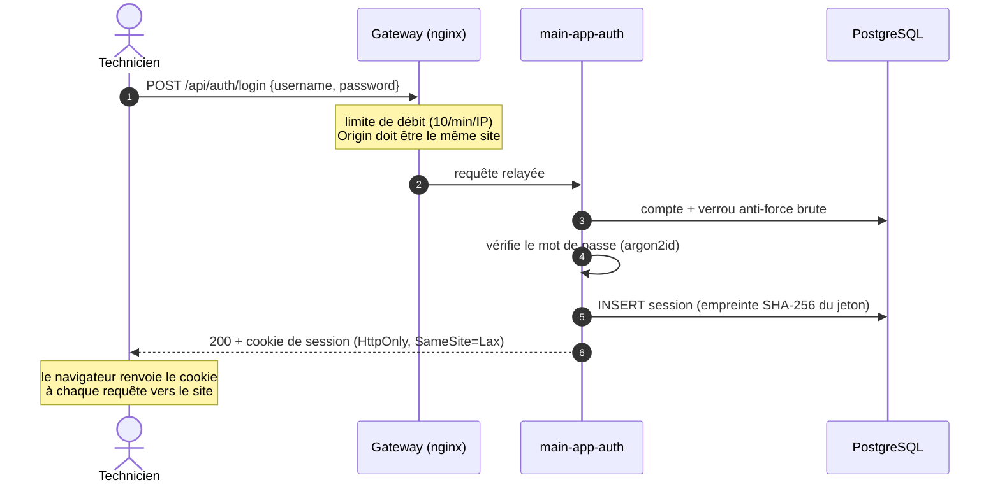
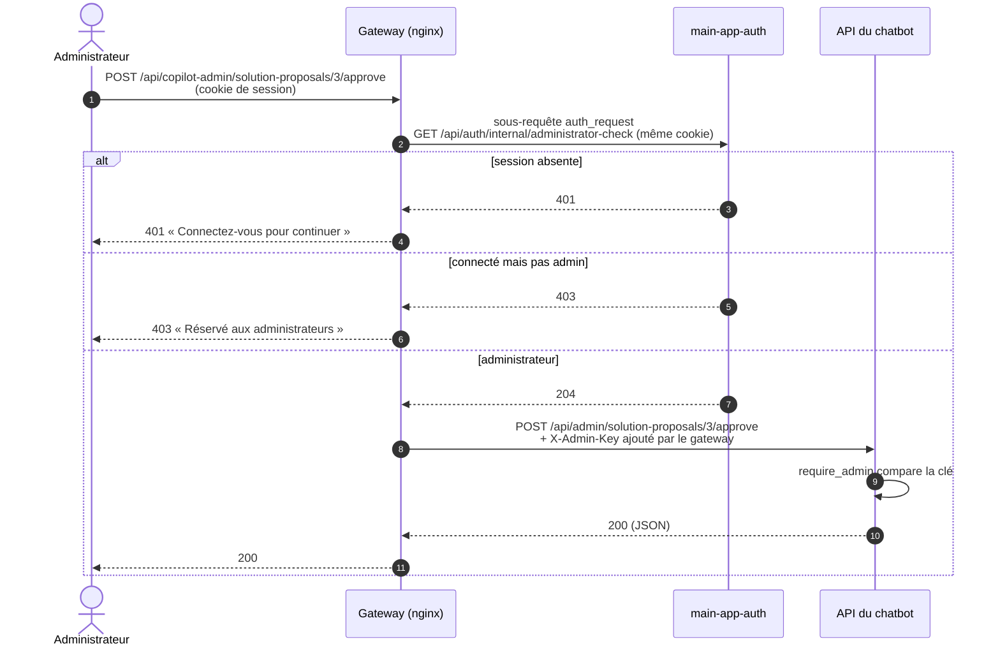

# Lancer le projet, interfaces, connexion et vérification des API

Ce document explique, de bout en bout :

1. [comment lancer tout le projet](#1-lancer-le-projet) ;
2. [quelles interfaces (pages et API) il expose](#2-les-interfaces-du-projet) ;
3. [comment fonctionne le système de connexion (login)](#3-le-système-de-connexion) ;
4. [comment chaque API vérifie qui l'appelle](#4-la-vérification-des-api) ;
5. [comment la connexion et ces vérifications sont reliées entre elles et au chatbot](#5-comment-tout-est-relié), et comment protéger une nouvelle route.

Les diagrammes sont en [Mermaid](https://mermaid.js.org/). GitHub, GitLab et VS Code (avec l'extension *Markdown Preview Mermaid Support*) les affichent directement.

---

## Vue d'ensemble

Le projet contient **deux applications** qui partagent une base PostgreSQL :

| Application | Rôle | Code | Fichier Docker Compose |
|---|---|---|---|
| **Chatbot (Copilote)** | Diagnostic des pannes GAB et TPE, à l'écrit ou à la voix | `app/` (API FastAPI), `frontend/` (pages) | `docker-compose.yml`, `frontend/docker-compose.yml` |
| **Espace techniciens** (main app) | Connexion, carte partagée, messagerie, appels, administration | `main-app/` | `docker-compose.main-app.yml` |

L'Espace techniciens est la porte d'entrée : on s'y connecte, puis on retrouve le chatbot dans l'onglet **Copilote** et son administration dans la page **Administration**.



---

## 1. Lancer le projet

### 1.1 Prérequis

- Docker et Docker Compose (sous Windows : Docker dans WSL ou Docker Desktop).
- Pour le chatbot : une clé d'IA de langage (Claude ou Gemini) et une clé Voyage AI (embeddings).
- Une carte graphique NVIDIA est déclarée pour l'API du chatbot (`gpus: all` dans `docker-compose.yml`).

### 1.2 Créer le fichier `.env`

Copier `.env.example` en `.env` à la racine du dépôt, puis remplir :

**Chatbot**

| Variable | Obligatoire | Rôle |
|---|---|---|
| `DATABASE_URL` | oui | Connexion à la base (la valeur du modèle convient en local) |
| `LLM_PROVIDER` | oui | `claude` (défaut) ou `gemini` |
| `CLAUDE_API_KEY` / `GEMINI_API_KEY` | selon le fournisseur | Clé de l'IA de langage |
| `VOYAGE_API_KEY`, `VOYAGE_MODEL` | oui | Embeddings (recherche des cas similaires) |
| `ADMIN_API_KEY` | **oui pour l'administration** | Clé de l'API d'administration du chatbot. Sans elle, toute l'administration du Copilote est refusée. Exemple : `openssl rand -hex 32` |

**Espace techniciens**

| Variable | Obligatoire | Rôle |
|---|---|---|
| `MAIN_APP_DATABASE_PASSWORD` | oui | Mot de passe du rôle SQL `main_app_user` (16 caractères ou plus) |
| `MAIN_APP_MAP_TILE_URL_TEMPLATE` | oui | Fournisseur des fonds de carte, ex. `https://tile.openstreetmap.org/{z}/{x}/{y}.png` |
| `MAIN_APP_MAP_TILE_USER_AGENT` | oui | Nom de l'application et contact, exigés par OpenStreetMap |
| `MAIN_APP_CHATBOT_PUBLIC_URL` | non (défaut `http://localhost:5173`) | Adresse du frontend du chatbot **vue par le navigateur**, affichée dans l'onglet Copilote |
| `MAIN_APP_PUBLIC_ORIGIN` | en production | Adresse publique exacte de l'Espace techniciens (défaut `http://localhost:8080`) |

**En local, sans HTTPS**, ajouter :

```env
MAIN_APP_ENVIRONMENT=development
MAIN_APP_COOKIE_SECURE=false
```

Sans ces deux lignes, le cookie de session est marqué `Secure` et certains navigateurs ne le renvoient pas en HTTP : la connexion semble ne jamais aboutir.

### 1.3 Démarrer

Toutes les commandes se lancent depuis la racine du dépôt.

```bash
# 1. Image de base Python du chatbot (une seule fois, puis après un changement de requirements.txt)
docker build -f Dockerfile.base -t atm-python-base:latest .

# 2. Base de données, API du chatbot et Espace techniciens
docker compose -f docker-compose.yml -f docker-compose.main-app.yml up -d --build

# 3. Pages du chatbot (onglet Copilote)
docker compose -f frontend/docker-compose.yml up -d --build

# 4. Premier administrateur de l'Espace techniciens (saisie interactive, mot de passe masqué)
docker compose -f docker-compose.yml -f docker-compose.main-app.yml exec main-app-auth node src/jobs/createAdmin.js
```

Au premier démarrage, le conteneur `init-db` applique les migrations `db/migrations/0001` à `0018` (chatbot puis Espace techniciens) et insère les données de démonstration. Le job `main-app-database-setup` donne ensuite son mot de passe au rôle SQL de l'Espace techniciens.

> **Toujours lancer les deux fichiers ensemble** (`-f docker-compose.yml -f docker-compose.main-app.yml`). C'est le second fichier qui branche l'API du chatbot sur le réseau du gateway : lancé seul, `docker-compose.yml` démarre un chatbot que l'administration ne peut pas joindre.

### 1.4 Ouvrir

| Adresse | Contenu |
|---|---|
| <http://localhost:8080> | **Espace techniciens** : c'est l'adresse à donner aux techniciens |
| <http://localhost:5173> | Chatbot seul (sans l'Espace techniciens) |
| <http://localhost:8000/docs> | Documentation interactive de l'API du chatbot (FastAPI) |

### 1.5 Vérifier que tout répond

```bash
curl -s http://localhost:8080/health              # {"status":"ok","feature":"gateway"}
curl -s -o /dev/null -w '%{http_code}\n' http://localhost:8080/auth/login.html   # 200 : conteneur auth joignable
curl -s http://localhost:8080/copilot/settings.json   # {"chatbotUrl":"http://localhost:5173"}
curl -s http://localhost:8000/health              # API du chatbot
```

Ensuite, dans le navigateur, connecté en administrateur : **Administration → Propositions** doit afficher une liste (même vide) et non « Copilote momentanément indisponible ».

### 1.6 Ne plus se connecter à chaque test (développement)

```env
MAIN_APP_DEVELOPMENT_AUTO_LOGIN_USERNAME=alan_admin
```

Toute requête **sans session** agit alors comme ce compte (qui doit exister). Une vraie session reste prioritaire, ce qui permet de tester à deux comptes. Cette option est **refusée au démarrage** si `MAIN_APP_ENVIRONMENT=production`.

### 1.7 Commandes utiles

Préfixe : `docker compose -f docker-compose.yml -f docker-compose.main-app.yml`

| Action | Commande |
|---|---|
| État des conteneurs | `ps` |
| Journaux d'un service | `logs -f main-app-gateway` |
| Redémarrer un service | `restart main-app-auth` |
| Reconstruire un service après modification | `up -d --build --no-deps main-app-gateway` |
| Tout arrêter (données conservées) | `down` |

La configuration nginx est copiée **dans l'image** du gateway : après une modification de `main-app/gateway/`, il faut reconstruire `main-app-gateway`.

---

## 2. Les interfaces du projet

### 2.1 Pages de l'Espace techniciens (port 8080)

| Page | Adresse | Accès |
|---|---|---|
| Connexion | `/auth/login.html` | public |
| Inscription | `/auth/register.html` | public, si `MAIN_APP_ALLOW_REGISTRATION=true` |
| Accueil | `/` | connecté |
| **Copilote** (chatbot intégré) | `/copilot/` | connecté |
| Carte partagée | `/map/` | connecté |
| Messagerie | `/messaging/` | connecté |
| Appels | `/calls/` | connecté |
| **Administration** | `/admin/` | administrateur |

La page Administration a une rubrique par sujet ; la rubrique ouverte suit l'adresse :

| Rubrique | Adresse | Contenu |
|---|---|---|
| Comptes | `/admin/#comptes` | Comptes et rôles de l'Espace techniciens |
| Propositions | `/admin/#propositions` | Solutions proposées par les techniciens depuis le Copilote, à approuver ou rejeter |
| Ajouts d'intervention | `/admin/#interventions` | Interventions racontées depuis le Copilote, à approuver ou rejeter |
| Codes d'erreur | `/admin/#codes-erreur` | Réponses enregistrées du menu « Codes d'erreur connus » |
| Pannes fréquentes | `/admin/#pannes-frequentes` | Réponses enregistrées du menu « Pannes fréquentes » |

### 2.2 Pages du chatbot (port 5173)

| Page | Adresse | Rôle |
|---|---|---|
| Accueil et connexion | `/` | Choix du technicien (voir [3.4](#34-la-connexion-du-chatbot)) |
| Copilote | `/copilot.html` | Conversation écrite et vocale. Affichée dans l'onglet Copilote de l'Espace techniciens avec `?embedded=1` |
| Diagnostic | `/diagnostic.html` | Recherche guidée |
| Présentation | `/flow-presentation.html` | Présentation du parcours |
| Administration (ancienne) | `/admin.html` | Même contenu que les rubriques Copilote de `/admin/`, mais avec la clé `ADMIN_API_KEY` à saisir. Utile seulement si le chatbot tourne sans l'Espace techniciens |

### 2.3 API

| Préfixe | Servi par | Protection | Détail |
|---|---|---|---|
| `/api/auth/` | `main-app-auth` (via le gateway) | session, rôle admin pour `/accounts` | [docs/main-app/fonctionnement.md § 8](main-app/fonctionnement.md#8-liste-des-routes-de-lapi) |
| `/api/map/` | `main-app-map` (via le gateway) | session | idem |
| `/api/messaging/` | `main-app-messaging` (via le gateway) | session | idem |
| `/api/calls/` et WebSocket `/api/calls/ws` | `main-app-calls` (via le gateway) | session (+ origine pour le WebSocket) | idem |
| `/api/copilot-admin/` | gateway → API du chatbot `/api/admin/` | session **admin** + clé ajoutée par le gateway | [§ 4.3](#43-administration-du-copilote--session-admin-puis-clé-du-chatbot) |
| `/api/chat`, `/api/error_code`, `/api/usual_problem`, `/api/intervention_add`, `/catalog`, `/interventions` | API du chatbot (port 8000, via le frontend 5173) | **aucune** (le technicien est un champ `technician_id`) | `http://localhost:8000/docs` |
| `/api/admin/` | API du chatbot | en-tête `X-Admin-Key` | idem |

### 2.4 Ports publiés sur la machine

| Port | Service | Remarque |
|---|---|---|
| 8080 | `main-app-gateway` | Seule entrée de l'Espace techniciens. Publié sur `127.0.0.1` par défaut (`MAIN_APP_GATEWAY_PUBLISHED_ADDRESS`) |
| 5173 | `atm_frontend` | Pages du chatbot |
| 8000 | `atm_app` (`web`) | API du chatbot |
| 5432 | `atm_db` | PostgreSQL |

Les conteneurs `main-app-auth`, `-map`, `-messaging` et `-calls` ne publient **aucun** port : on ne les joint que par le gateway.

---

## 3. Le système de connexion

La connexion appartient à **l'Espace techniciens**, conteneur `main-app-auth`. Le chatbot n'a pas de vraie connexion (voir [3.4](#34-la-connexion-du-chatbot)).

### 3.1 Comptes et identité

- Chaque compte (`main_app.accounts`) est rattaché à une ligne de `public.technician`, la table des techniciens **du chatbot**. Le n° de compte et le n° de technicien du chatbot sont donc le même nombre : c'est ce qui permet au Copilote de savoir quel technicien parle.
- Rôles : `technician`, `moderator` (gère tous les points de la carte), `admin` (gère aussi les comptes et administre le Copilote).
- Le premier admin se crée avec `createAdmin.js` ([§ 1.3](#13-démarrer)). Les suivants se créent dans **Administration → Comptes**.

### 3.2 Déroulé d'une connexion



Points clés :

- le cookie contient un **jeton aléatoire** de 32 octets ; la base n'en garde que l'empreinte SHA-256 ;
- le cookie s'appelle `__Host-main_app_session` en HTTPS, `main_app_session` en développement HTTP ;
- durée : `MAIN_APP_SESSION_DURATION_HOURS` (12 h par défaut). Déconnexion, mot de passe réinitialisé ou compte désactivé suppriment les sessions ;
- même message d'erreur que le compte existe ou non ; verrouillage temporaire après `MAIN_APP_LOGIN_MAX_FAILED_ATTEMPTS` échecs.

### 3.3 Côté pages

Chaque page connectée charge `main-app/gateway/html/shared/js/connectedPageShell.js`, qui :

1. appelle `GET /api/auth/me` ;
2. sur **401**, renvoie vers `/auth/login.html?next=<page>` (retour à la page après connexion) ;
3. sinon dessine la navigation ; le lien **Administration** n'apparaît que pour le rôle `admin`.

Masquer un lien ne protège rien : **c'est toujours le serveur qui décide** ([§ 4](#4-la-vérification-des-api)).

### 3.4 La connexion du chatbot

Le chatbot n'a **pas** de système de connexion : sa page d'accueil demande un n° de technicien et un nom, gardés dans le `localStorage` du navigateur (`frontend/public/js/services/api/authApi.js`, marqué « MOCK »). Son API croit le `technician_id` envoyé dans chaque requête.

Dans l'onglet Copilote, l'Espace techniciens remplit ce choix **à la place de l'utilisateur** : la page `/copilot/` charge

```
http://localhost:5173/copilot.html?embedded=1&theme=dark&technician_id=7&display_name=Alan%20Martin
```

et `frontend/public/js/embeddedMode.js` enregistre ce technicien avant que le Copilote démarre. L'utilisateur ne se connecte donc qu'une fois, dans l'Espace techniciens. **C'est un confort, pas une sécurité** : voir [5.4](#54-limite-actuelle--les-routes-non-admin-du-chatbot).

---

## 4. La vérification des API

Trois mécanismes, selon l'API appelée.

### 4.1 API de l'Espace techniciens : le cookie de session

Chaque conteneur vérifie la session **lui-même**, sans demander au conteneur auth : si `main-app-auth` est arrêté, la carte ou la messagerie continuent de fonctionner pour les personnes déjà connectées.

La vérification est faite par deux middlewares Express partagés (`main-app/src/middlewares/`) :

| Middleware | Ce qu'il fait | Refus |
|---|---|---|
| `requireAuthenticatedUser` | Lit le cookie, cherche l'empreinte du jeton dans `main_app.sessions` (session non expirée, compte actif), puis pose `request.user = { technicianId, username, role }` | **401** |
| `requireRole("admin", …)` | À placer après le précédent : vérifie `request.user.role` | **403** |

L'identité vient **uniquement** du cookie vérifié en base : un en-tête du type `X-User-Id` envoyé par un client est ignoré.

Le WebSocket des appels (`/api/calls/ws`) vérifie en plus que l'en-tête `Origin` vaut exactement `MAIN_APP_PUBLIC_ORIGIN`.

### 4.2 Le gateway : contrôles communs avant tout conteneur

`main-app/gateway/nginx.conf` applique à **toutes** les API :

| Contrôle | Effet |
|---|---|
| Anti-CSRF | Une écriture (`POST`, `PUT`, `PATCH`, `DELETE`) dont l'`Origin` n'est pas le site lui-même est refusée (**403**) |
| Limites de débit | Connexion, inscription, messages, pièces jointes, API en général (**429**) |
| Routes internes | Toute adresse `/internal/` ou `/api/<module>/internal/` répond **404** depuis l'extérieur |
| En-têtes de sécurité | CSP stricte, `X-Frame-Options`, `Permissions-Policy`, etc. |
| Service arrêté | **503** « service indisponible » pour ce module seulement |

### 4.3 Administration du Copilote : session admin, puis clé du chatbot

L'API d'administration du chatbot n'accepte qu'une chose : l'en-tête `X-Admin-Key` égal à `ADMIN_API_KEY` (`app/api/routes/admin.py`, `require_admin`). Pour que les administrateurs de l'Espace techniciens s'en servent **sans connaître la clé**, le gateway fait le lien :



Ce qui garantit la sécurité :

- **la clé ne quitte jamais le serveur** : elle est dans l'environnement du gateway (`MAIN_APP_CHATBOT_ADMIN_API_KEY`, recopiée depuis `ADMIN_API_KEY` par `docker-compose.main-app.yml`) ;
- un en-tête `X-Admin-Key` envoyé par le navigateur est **écrasé** par le gateway : un technicien qui connaîtrait la clé n'obtient quand même que 403 ;
- la route de contrôle `/api/auth/internal/administrator-check` n'est joignable que par le gateway (404 depuis l'extérieur) ;
- l'anti-CSRF et la limite de débit du § 4.2 s'appliquent aussi.

Où chaque pièce est configurée :

| Pièce | Fichier |
|---|---|
| Relais, `auth_request`, ajout de la clé | `main-app/gateway/nginx.conf` (blocs `location /api/copilot-admin/` et `/__internal/administrator-check`) |
| Clé et adresse du chatbot écrites au démarrage | `main-app/gateway/templates/copilot-settings.conf.template` → `/tmp/copilot-settings.conf` |
| Route de contrôle admin | `main-app/src/routes/auth/authRoutes.js` (`/internal/administrator-check`) |
| Réseau : le gateway joint l'API du chatbot sous le nom `chatbot-api` | `docker-compose.main-app.yml` (service `web`) |
| Appels depuis la page Administration | `main-app/gateway/html/admin/js/copilotAdminApi.js` |

---

## 5. Comment tout est relié

### 5.1 Récapitulatif

| Ce que fait l'utilisateur | Qui vérifie | Comment |
|---|---|---|
| Se connecter | `main-app-auth` | Mot de passe → session en base → cookie |
| Utiliser la carte, la messagerie, les appels | chaque conteneur | `requireAuthenticatedUser` (cookie → session en base) |
| Gérer les comptes | `main-app-auth` | `requireAuthenticatedUser` + `requireRole("admin")` |
| Valider une proposition, modifier un code d'erreur… | gateway puis chatbot | `auth_request` (session admin) puis `X-Admin-Key` ajouté par le gateway |
| Discuter avec le Copilote | personne | Le technicien est transmis à l'iframe et à l'API dans `technician_id` |

### 5.2 Protéger une nouvelle route de l'Espace techniciens

Exemple : une route `GET /api/map/statistics` réservée aux modérateurs et aux admins.

```js
// main-app/src/routes/map/mapRoutes.js
import { requireAuthenticatedUser } from "../../middlewares/requireAuthenticatedUser.js";
import { requireRole } from "../../middlewares/requireRole.js";

mapRouter.get(
  "/statistics",
  requireAuthenticatedUser,               // 401 sans session valide
  requireRole("moderator", "admin"),      // 403 pour un autre rôle
  asyncHandler(readMapStatistics),        // request.user est disponible ici
);
```

Rien à changer dans le gateway : `/api/map/` y est déjà relayé avec l'anti-CSRF et la limite de débit. Ajouter un test d'intégration (401 / 403 / 200), sur le modèle de `main-app/tests/integration/auth/authentication.test.js`.

### 5.3 Rendre une nouvelle route admin du chatbot utilisable depuis `/admin/`

1. Dans le chatbot, déclarer la route sous `/api/admin/…` avec la dépendance existante :

   ```python
   # app/api/routes/admin_xxx.py
   router = APIRouter(prefix="/api/admin/xxx", tags=["admin"], dependencies=[Depends(require_admin)])
   ```

   et l'inclure dans `app/main.py`.
2. **Rien à changer dans le gateway** : tout `/api/copilot-admin/<chemin>` est relayé vers `/api/admin/<chemin>` avec la vérification admin.
3. Côté page, appeler `requestCopilotAdmin("/xxx")` (`main-app/gateway/html/admin/js/copilotAdminApi.js`), puis ajouter une rubrique dans `admin/index.html` et un module `*Section.js` branché dans `administrationPage.js`.

### 5.4 Limite actuelle : les routes non admin du chatbot

Les routes du chat (`/api/chat`, `/api/intervention_add`, …) **ne vérifient pas qui les appelle** : elles croient le `technician_id` reçu, et l'API (8000) comme le frontend (5173) sont publiés sur toutes les interfaces de la machine. Quelqu'un qui joint ces ports peut donc parler au Copilote au nom de n'importe quel technicien. C'est acceptable en démonstration locale, **pas en production**.

Marche à suivre pour les relier au vrai login (**non réalisé à ce jour**) :

1. **Ne plus exposer le chatbot directement** : dans `docker-compose.yml`, publier `8000` et `5173` sur `127.0.0.1` seulement (ou plus du tout), et servir les pages du chatbot par le gateway, sous une adresse de l'Espace techniciens.
2. **Relayer les routes du chat par le gateway avec `auth_request`**, comme pour l'administration, mais vers une route de contrôle qui accepte tout utilisateur connecté et renvoie son identité :

   ```js
   // main-app-auth : 204 + identité dans un en-tête de réponse
   authRouter.get("/internal/session-check", requireAuthenticatedUser, (request, response) => {
     response.set("X-Authenticated-Technician-Id", String(request.user.technicianId)).status(204).end();
   });
   ```

   ```nginx
   # gateway : l'identité est recopiée dans la requête vers le chatbot ; celle du client est écrasée
   auth_request /__internal/session-check;
   auth_request_set $authenticated_technician_id $upstream_http_x_authenticated_technician_id;
   proxy_set_header X-Authenticated-Technician-Id $authenticated_technician_id;
   ```

3. **Dans le chatbot, lire le technicien dans cet en-tête** au lieu du champ `technician_id` (une dépendance FastAPI commune), et refuser une requête sans en-tête. Le chatbot ne doit alors être joignable **que** par le gateway, sinon l'en-tête pourrait être inventé.
4. Supprimer le choix du technicien dans le mode intégré (`technician_id` dans l'adresse de l'iframe), devenu inutile.

---

## Pour aller plus loin

| Sujet | Document |
|---|---|
| Espace techniciens : présentation, modules | [main-app/README.md](main-app/README.md) |
| Fonctionnement de chaque module, liste complète des routes | [main-app/fonctionnement.md](main-app/fonctionnement.md) |
| Sécurité, conteneurs, variables en détail | [main-app.md](main-app.md) |
| Schéma SQL | [main-app/base-de-donnees.md](main-app/base-de-donnees.md) |
| Fonctionnement du chatbot | [../README.md](../README.md), [../COMPREHENSION.md](../COMPREHENSION.md) |
