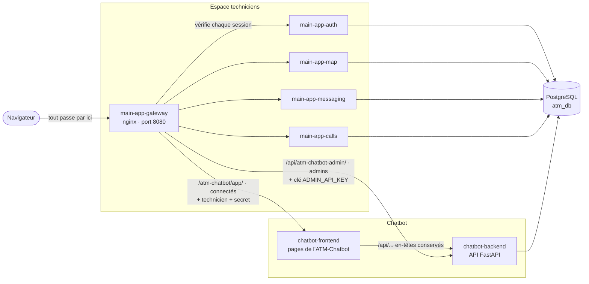
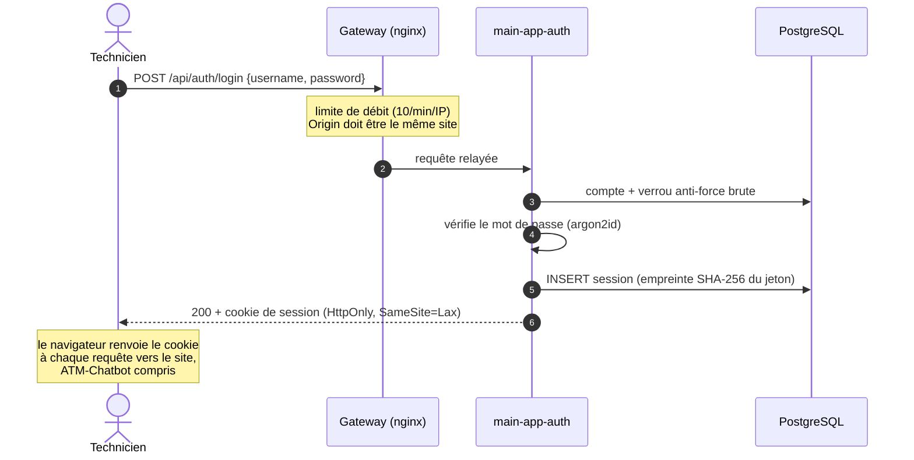
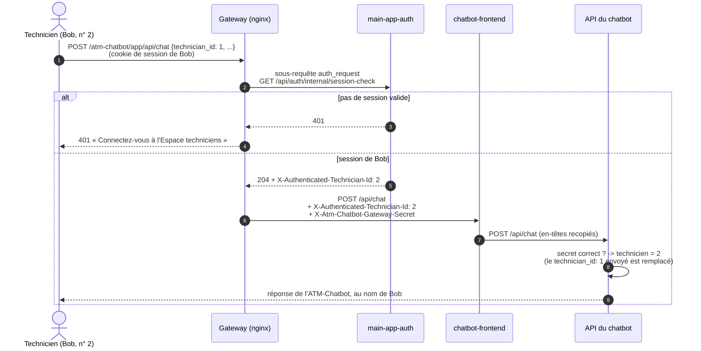
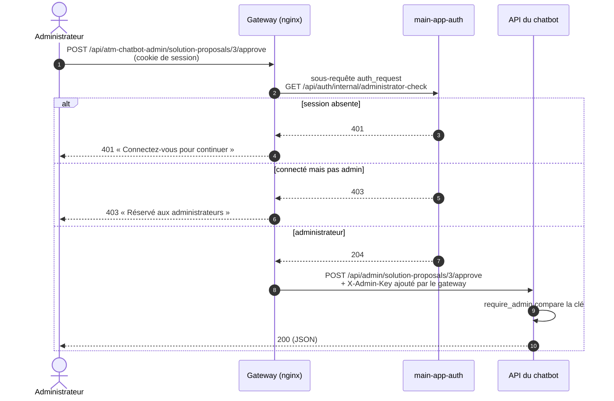

# Lancer le projet, interfaces, connexion et vérification des API

Ce document explique, de bout en bout :

1. [comment lancer tout le projet](#1-lancer-le-projet) ;
2. [quelles interfaces (pages et API) il expose](#2-les-interfaces-du-projet) ;
3. [comment fonctionne le système de connexion (login)](#3-le-système-de-connexion) ;
4. [comment chaque API vérifie qui l'appelle](#4-la-vérification-des-api) ;
5. [comment tout est relié](#5-comment-tout-est-relié), et comment protéger une nouvelle route.

Les diagrammes sont en [Mermaid](https://mermaid.js.org/). GitHub, GitLab et VS Code (avec l'extension *Markdown Preview Mermaid Support*) les affichent directement.

---

## Vue d'ensemble

Le projet contient **deux applications** qui partagent une base PostgreSQL :

| Application | Rôle | Code |
|---|---|---|
| **Chatbot (ATM-Chatbot)** | Diagnostic des pannes GAB et TPE, à l'écrit ou à la voix | `app/` (API FastAPI), `frontend/` (pages) |
| **Espace techniciens** (main app) | Connexion, carte partagée, messagerie, appels, administration | `main-app/` |

**L'Espace techniciens est la seule porte d'entrée.** On s'y connecte une fois, puis on retrouve le chatbot dans l'onglet **ATM-Chatbot** et son administration dans la page **Administration**. Le navigateur ne parle qu'au gateway : c'est lui qui joint le chatbot, après avoir vérifié la session.

La page `/admin/` et tous ses fichiers sont également protégés côté gateway :
sans session, redirection vers la connexion ; avec un compte technicien ou
modérateur, redirection vers l'accueil, sans servir le HTML d'administration.
Après connexion, un retour `?next=/admin/` n'est conservé que pour un administrateur.
Les API administratives vérifient toujours les droits indépendamment de ces
redirections. Si le service de connexion est indisponible, le gateway refuse de
servir l'administration (503) ; la page ne déverrouille pas les rubriques sans rôle vérifié.



---

## 1. Lancer le projet

### Lancement local recommandé (Windows / WSL)

Depuis PowerShell : `.\start.ps1`. Depuis WSL : `bash start.sh`.
Cette commande lance toutes les applications, prépare les paramètres manquants,
réutilise la base et les pièces jointes existantes, crée le premier administrateur
si nécessaire et affiche toutes les adresses et tous les ports après vérification.
Elle n'ajoute pas de données de démonstration. Les identifiants initiaux, seulement
si aucun administrateur actif n'existe, sont dans `.local/initial-admin.json`
(non suivi par Git ; changer le mot de passe puis supprimer ce fichier).

Ce lancement est en **développement local HTTP**, sans GPU obligatoire ni
certificat. Les commandes historiques ci-dessous restent disponibles ; pour le
nouveau lanceur et ses options, voir le [README racine](../README.md).

### Erreur « Service momentanément indisponible » dans l'administration

Les propositions, interventions et réponses enregistrées dépendent du service
`chatbot-backend` (API du chatbot), même si la connexion et les comptes fonctionnent encore.
Vérifier `docker compose ps` puis `docker compose logs --tail 80 chatbot-backend`.
Une erreur `Input/output error` ou CRC pendant un import Python indique un
problème de lecture du disque, pas un mot de passe incorrect. Sauvegarder le
projet sur un disque sain et récupérer les fichiers illisibles depuis Git après
confirmation ; ne pas réinitialiser la base ni supprimer ses volumes.

Après déplacement du projet, relancer depuis son nouveau dossier avec
`.\start.ps1` pour recréer les conteneurs avec les bons chemins de montage.
La base et les pièces jointes restent dans les volumes Docker du projet
`atm-chatbot`. Les fichiers `.env` et `.local/` restent locaux et ne doivent
jamais être poussés sur GitHub.

### 1.1 Prérequis

- Docker et Docker Compose (sous Windows : Docker dans WSL ou Docker Desktop).
- Pour le chatbot : une clé d'IA de langage (Claude ou Gemini) et une clé Voyage AI (embeddings).
- Aucun GPU n'est requis : les embeddings et le langage utilisent les API Voyage et Claude/Gemini, sans PyTorch/CUDA local.

### 1.2 Créer le fichier `.env`

Copier `.env.example` en `.env` à la racine du dépôt, puis remplir :

**Chatbot**

| Variable | Obligatoire | Rôle |
|---|---|---|
| `DATABASE_URL` | oui | Connexion à la base (la valeur du modèle convient en local) |
| `LLM_PROVIDER` | oui | `claude` (défaut) ou `gemini` |
| `CLAUDE_API_KEY` / `GEMINI_API_KEY` | selon le fournisseur | Clé de l'IA de langage |
| `VOYAGE_API_KEY`, `VOYAGE_MODEL` | oui | Embeddings (recherche des cas similaires) |
| `ADMIN_API_KEY` | **oui** | Clé de l'API d'administration du chatbot. Sans elle, l'administration de l’ATM-Chatbot est refusée. Exemple : `openssl rand -hex 32` |

**Espace techniciens**

| Variable | Obligatoire | Rôle |
|---|---|---|
| `ATM_CHATBOT_GATEWAY_SHARED_SECRET` | **oui** | Mot de passe interne entre le gateway et l'API du chatbot (voir l'encadré ci-dessous). 32 caractères ou plus : `openssl rand -hex 32` |
| `MAIN_APP_DATABASE_PASSWORD` | oui | Mot de passe du rôle SQL `main_app_user` (16 caractères ou plus) |
| `MAIN_APP_MAP_TILE_URL_TEMPLATE` | oui | Fournisseur des fonds de carte, ex. `https://tile.openstreetmap.org/{z}/{x}/{y}.png` |
| `MAIN_APP_MAP_TILE_USER_AGENT` | oui | Nom de l'application et contact, exigés par OpenStreetMap |
| `MAIN_APP_PUBLIC_ORIGIN` | en production | Adresse publique exacte de l'Espace techniciens (défaut `http://localhost:8080`) |

> **À quoi sert `ATM_CHATBOT_GATEWAY_SHARED_SECRET`, en clair ?**
> Quand un technicien écrit à l'ATM-Chatbot, sa requête passe d'abord par le gateway, qui vérifie qu'il est connecté, puis arrive à l'API du chatbot avec la mention « c'est le technicien n° 7 ». L'API doit pouvoir croire cette mention : sinon, n'importe qui joignant l'API pourrait écrire « je suis le n° 7 ». Le secret est une longue suite de caractères aléatoires que **seuls** le gateway et l'API connaissent ; le gateway la joint à chaque requête, et l'API refuse toute requête qui ne l'a pas.
> Personne n'a besoin de la retenir ni de la saisir : il suffit qu'elle soit présente dans `.env` (docker compose la transmet aux deux conteneurs). Si elle manque, `docker compose` refuse de démarrer avec le message « ATM_CHATBOT_GATEWAY_SHARED_SECRET manquant dans .env ».

**En local, sans HTTPS**, ajouter :

```env
MAIN_APP_ENVIRONMENT=development
MAIN_APP_COOKIE_SECURE=false
```

Sans ces deux lignes, le cookie de session est marqué `Secure` et certains navigateurs ne le renvoient pas en HTTP : la connexion semble ne jamais aboutir.

### 1.3 Démarrer

Toutes les commandes se lancent depuis la racine du dépôt.

```bash
# 1. Tout construire, y compris automatiquement l'image de base Python.
docker compose -f compose.backend.yaml -f docker-compose.main-app.yml up -d --build

# 2. Premier administrateur de l'Espace techniciens (saisie interactive, mot de passe masqué)
docker compose -f compose.backend.yaml -f docker-compose.main-app.yml exec main-app-auth node src/jobs/createAdmin.js
```

Au premier démarrage, le conteneur `init-db` applique les migrations `db/migrations/0001` à `0019`
(chatbot puis Espace techniciens, puis noms français). Avec les deux fichiers historiques
seuls, il insère aussi les données de démonstration ; le fichier local désactive ce seed.
Le job `main-app-database-setup` donne ensuite son mot de passe au rôle SQL de l'Espace techniciens.

> **Toujours lancer les deux fichiers ensemble** (`-f compose.backend.yaml -f docker-compose.main-app.yml`). C'est le second qui ajoute les pages de l’ATM-Chatbot (`chatbot-frontend`), branche l'API du chatbot sur le réseau du gateway et lui donne le secret partagé.

**Chatbot seul, sans l'Espace techniciens** (démonstration, développement du chatbot) : `docker compose up -d --build`, puis `docker compose -f frontend/docker-compose.yml up -d --build` et <http://localhost:5173>. Sans `ATM_CHATBOT_GATEWAY_SHARED_SECRET` dans l'environnement de l'API, le chatbot reprend son fonctionnement d'origine (connexion simulée, voir [3.4](#34-atm-chatbot-et-connexion)).

### 1.4 Ouvrir

| Adresse | Contenu |
|---|---|
| <http://localhost:8080> | **Espace techniciens**, la seule adresse à donner aux techniciens |
| <http://localhost:8000/docs> | Documentation de l'API du chatbot (consultation ; les appels sans le gateway sont refusés) |

### 1.5 Vérifier que tout répond

```bash
curl -s http://localhost:8080/health                                  # {"status":"ok","feature":"gateway"}
curl -s -o /dev/null -w '%{http_code}\n' http://localhost:8080/auth/login.html   # 200 : conteneur auth joignable
curl -s -o /dev/null -w '%{http_code}\n' http://localhost:8080/atm-chatbot/app/      # 401 sans session : l’ATM-Chatbot est protégé
curl -s http://localhost:8000/health                                  # {"status":"ok"} : API du chatbot
curl -s -o /dev/null -w '%{http_code}\n' "http://localhost:8000/api/usual_problem?device_type=gab"  # 401 : appel direct refusé
```

Puis, dans le navigateur, connecté : l'onglet **ATM-Chatbot** affiche « Bonjour <votre nom> » ; connecté en administrateur, **Administration → Propositions** affiche une liste (même vide) et non « ATM-Chatbot momentanément indisponible ».

### 1.6 Ne plus se connecter à chaque test (développement)

```env
MAIN_APP_DEVELOPMENT_AUTO_LOGIN_USERNAME=alan_admin
```

Toute requête **sans session** agit alors comme ce compte (qui doit exister), y compris dans l’ATM-Chatbot. Une vraie session reste prioritaire, ce qui permet de tester à deux comptes. Cette option est **refusée au démarrage** si `MAIN_APP_ENVIRONMENT=production`.

### 1.7 Commandes utiles

Préfixe : `docker compose -f compose.backend.yaml -f docker-compose.main-app.yml`

| Action | Commande |
|---|---|
| État des conteneurs | `ps` |
| Journaux d'un service | `logs -f main-app-gateway` |
| Redémarrer un service | `restart main-app-auth` |
| Reconstruire un service après modification | `up -d --build --no-deps main-app-gateway` |
| Tout arrêter (données conservées) | `down` |

La configuration nginx et les pages de l’ATM-Chatbot sont copiées **dans les images** : après une modification de `main-app/gateway/` ou de `frontend/`, reconstruire `main-app-gateway` ou `chatbot-frontend`.

---

## 2. Les interfaces du projet

### 2.1 Pages (toutes sur le port 8080)

| Page | Adresse | Accès |
|---|---|---|
| Connexion | `/auth/login.html` | public |
| Inscription | `/auth/register.html` | public, si `MAIN_APP_ALLOW_REGISTRATION=true` |
| Accueil | `/` | connecté |
| **ATM-Chatbot** (onglet) | `/atm-chatbot/` | connecté |
| Carte partagée | `/map/` | connecté |
| Messagerie | `/messaging/` | connecté |
| Appels | `/calls/` | connecté |
| **Administration** | `/admin/` | administrateur |

La page Administration a une rubrique par sujet ; la rubrique ouverte suit l'adresse :

| Rubrique | Adresse | Contenu |
|---|---|---|
| Comptes | `/admin/#comptes` | Comptes et rôles de l'Espace techniciens |
| Propositions | `/admin/#propositions` | Solutions proposées par les techniciens depuis l’ATM-Chatbot, à approuver ou rejeter |
| Ajouts d'intervention | `/admin/#interventions` | Interventions racontées depuis l’ATM-Chatbot, à approuver ou rejeter |
| Codes d'erreur | `/admin/#codes-erreur` | Réponses enregistrées du menu « Codes d'erreur connus » |
| Pannes fréquentes | `/admin/#pannes-frequentes` | Réponses enregistrées du menu « Pannes fréquentes » |

### 2.2 Pages du chatbot

Servies par le gateway sous `/atm-chatbot/app/` (réservé aux connectés). L'onglet ATM-Chatbot affiche la première dans une iframe.

| Page | Adresse | Rôle |
|---|---|---|
| ATM-Chatbot | `/atm-chatbot/app/atm-chatbot.html` | Conversation écrite et vocale (`?embedded=1` dans l'onglet : sans barre du haut) |
| Accueil du chatbot | `/atm-chatbot/app/` | Page d'accueil d'origine du chatbot |
| Diagnostic | `/atm-chatbot/app/diagnostic.html` | Recherche guidée |
| Présentation | `/atm-chatbot/app/flow-presentation.html` | Présentation du parcours |

L'ancienne page d'administration du chatbot (`admin.html`, clé à saisir) redirige vers `/admin/` quand on passe par le gateway.

Les pages du chatbot n'utilisent que des **chemins relatifs** (`css/…`, `api/…`) : elles fonctionnent aussi bien sous `/atm-chatbot/app/` qu'à la racine du port 5173 en mode chatbot seul.

### 2.3 API

| Adresse (via le gateway) | Servi par | Protection | Détail |
|---|---|---|---|
| `/api/auth/` | `main-app-auth` | session, rôle admin pour `/accounts` | [main-app/fonctionnement.md § 8](main-app/fonctionnement.md#8-liste-des-routes-de-lapi) |
| `/api/map/` | `main-app-map` | session | idem |
| `/api/messaging/` | `main-app-messaging` | session | idem |
| `/api/calls/`, WebSocket `/api/calls/ws` | `main-app-calls` | session (+ origine pour le WebSocket) | idem |
| `/atm-chatbot/app/api/…` | API du chatbot (`/api/…`), via `chatbot-frontend` | session + technicien transmis par le gateway | [§ 4.3](#43-atm-chatbot--session-puis-identité-transmise-au-chatbot) ; routes : `http://localhost:8000/docs` |
| `/api/atm-chatbot-admin/…` | API du chatbot (`/api/admin/…`) | session **admin** + clé ajoutée par le gateway | [§ 4.4](#44-administration-atm-chatbot--session-admin-puis-clé-du-chatbot) |

### 2.4 Ports publiés sur la machine

| Port | Service | Remarque |
|---|---|---|
| 8080 | `main-app-gateway` | Seule entrée utile. Publié sur `127.0.0.1` par défaut (`MAIN_APP_GATEWAY_PUBLISHED_ADDRESS`) |
| 8000 | `chatbot-backend` | API du chatbot. Publié par `compose.backend.yaml`, mais **refuse** tout appel qui ne vient pas du gateway (sauf `/health`, `/docs` et `/api/admin/` avec sa clé) |
| 5433 | `db` | PostgreSQL en local ; port interne 5432 |

`chatbot-frontend` et les conteneurs `main-app-auth`, `-map`, `-messaging`, `-calls` ne publient **aucun** port : on ne les joint que par le gateway.

---

## 3. Le système de connexion

La connexion appartient à **l'Espace techniciens**, conteneur `main-app-auth`. Le chatbot n'a pas de connexion propre : derrière l'Espace techniciens, il reçoit l'identité vérifiée ([3.4](#34-atm-chatbot-et-connexion)).

### 3.1 Comptes et identité

- Chaque compte (`main_app.comptes`) est rattaché à une ligne de `public.technicien`, la table des techniciens **du chatbot**. Le n° de compte et le n° de technicien du chatbot sont donc le même nombre : c'est ce qui permet à l’ATM-Chatbot de savoir quel technicien parle.
- Rôles : `technicien`, `moderator` (gère tous les points de la carte), `admin` (gère aussi les comptes et administre l’ATM-Chatbot).
- Le premier admin se crée avec `createAdmin.js` ([§ 1.3](#13-démarrer)). Les suivants se créent dans **Administration → Comptes**.

### 3.2 Déroulé d'une connexion



Points clés :

- le cookie contient un **jeton aléatoire** de 32 octets ; la base n'en garde que l'empreinte SHA-256 ;
- le cookie s'appelle `__Host-main_app_session` en HTTPS, `main_app_session` en développement HTTP ;
- durée : `MAIN_APP_SESSION_DURATION_HOURS` (12 h par défaut). Déconnexion, mot de passe réinitialisé ou compte désactivé suppriment les sessions, **et coupent donc aussi l'accès à l’ATM-Chatbot** ;
- même message d'erreur que le compte existe ou non ; verrouillage temporaire après `MAIN_APP_LOGIN_MAX_FAILED_ATTEMPTS` échecs.

### 3.3 Côté pages

Chaque page connectée charge `main-app/gateway/html/shared/js/connectedPageShell.js`, qui :

1. appelle `GET /api/auth/me` ;
2. sur **401**, renvoie vers `/auth/login.html?next=<page>` (retour à la page après connexion) ;
3. sinon dessine la navigation ; le lien **Administration** n'apparaît que pour le rôle `admin`.

Masquer un lien ne protège rien : **c'est toujours le serveur qui décide** ([§ 4](#4-la-vérification-des-api)).

### 3.4 ATM-Chatbot et connexion

Le chatbot a été conçu avec une connexion **simulée** : sa page d'accueil demande un n° de technicien et un nom, gardés dans le navigateur, et son API croyait le `technician_id` envoyé dans chaque requête.

Derrière l'Espace techniciens, ce n'est plus le cas :

| Étape | Qui | Quoi |
|---|---|---|
| Affichage | `/atm-chatbot/` (`atmChatbotPage.js`) | Charge `/atm-chatbot/app/atm-chatbot.html?embedded=1&theme=…&technician_id=…&display_name=…`. `frontend/public/js/embeddedMode.js` passe l'écran de connexion simulée et affiche le bon nom : **c'est seulement de l'affichage** |
| Requête | gateway | Vérifie la session, puis ajoute à la requête le n° du technicien connecté et le secret partagé ([§ 4.3](#43-atm-chatbot--session-puis-identité-transmise-au-chatbot)) |
| Traitement | API du chatbot (`app/core/gateway_identity.py`) | Refuse toute requête sans le bon secret ; **remplace** le `technician_id` envoyé par la page par celui de la session |

Résultat : un technicien ne peut ni utiliser l’ATM-Chatbot sans être connecté, ni parler au nom d'un collègue (en modifiant l'adresse de l'iframe ou le corps d'une requête), ni lire les conversations ou demandes d'un autre.

---

## 4. La vérification des API

Quatre mécanismes, selon l'API appelée.

### 4.1 API de l'Espace techniciens : le cookie de session

Chaque conteneur vérifie la session **lui-même**, sans demander au conteneur auth : si `main-app-auth` est arrêté, la carte ou la messagerie continuent de fonctionner pour les personnes déjà connectées.

La vérification est faite par deux middlewares Express partagés (`main-app/src/middlewares/`) :

| Middleware | Ce qu'il fait | Refus |
|---|---|---|
| `requireAuthenticatedUser` | Lit le cookie, cherche l'empreinte du jeton dans `main_app.sessions` (session non expirée, compte actif), puis pose `request.user = { technicianId, username, role }` | **401** |
| `requireRole("admin", …)` | À placer après le précédent : vérifie `request.user.role` | **403** |

L'identité vient **uniquement** du cookie vérifié en base : un en-tête du type `X-User-Id` envoyé par un client est ignoré.

Le WebSocket des appels (`/api/calls/ws`) vérifie en plus que l'en-tête `Origin` vaut exactement `MAIN_APP_PUBLIC_ORIGIN`.

### 4.2 Le gateway : contrôles communs avant tout conteneur

`main-app/gateway/nginx.conf` applique à **toutes** les API :

| Contrôle | Effet |
|---|---|
| Anti-CSRF | Une écriture (`POST`, `PUT`, `PATCH`, `DELETE`) dont l'`Origin` n'est pas le site lui-même est refusée (**403**) |
| Limites de débit | Connexion, inscription, messages, pièces jointes, API en général (**429**) |
| Routes internes | Toute adresse `/internal/` ou `/api/<module>/internal/` répond **404** depuis l'extérieur |
| En-têtes de sécurité | CSP stricte, `X-Frame-Options`, `Permissions-Policy`, etc. (règles assouplies seulement pour les pages du chatbot, voir plus bas) |
| Service arrêté | **503** « service indisponible » pour ce module seulement |

### 4.3 ATM-Chatbot : session, puis identité transmise au chatbot



| Pièce | Fichier |
|---|---|
| Relais `/atm-chatbot/app/` → `chatbot-frontend`, `auth_request`, en-têtes d'identité | `main-app/gateway/nginx.conf` (blocs `location /atm-chatbot/app/` et `/__internal/session-check`) |
| Route de contrôle de session (renvoie le n° du technicien) | `main-app/src/routes/auth/authRoutes.js` (`/internal/session-check`) |
| Recopie des en-têtes vers l'API | `frontend/server.py` (`FORWARDED_REQUEST_HEADERS`) |
| Vérification du secret, refus 401, remplacement du technicien | `app/core/gateway_identity.py`, utilisé par `app/api/routes/chat.py` et `intervention_add.py` |
| Secret | `ATM_CHATBOT_GATEWAY_SHARED_SECRET` (`.env`), passé au gateway et à l'API par `docker-compose.main-app.yml` |

Pourquoi un secret en plus de l'identité : l'API du chatbot est joignable sur le port 8000. Sans secret, n'importe quel programme pourrait envoyer `X-Authenticated-Technician-Id: 1`. Le secret n'est connu que du gateway et de l'API ; celui qu'un client enverrait est écrasé par le gateway.

Règles de sécurité propres aux pages du chatbot (`/atm-chatbot/app/`) : elles peuvent être affichées dans une iframe **du même site** (`X-Frame-Options: SAMEORIGIN`, `frame-ancestors 'self'`), charger la police Google Fonts, et utiliser le micro (dictée, chat vocal). Les scripts écrits dans le HTML restent interdits.

### 4.4 Administration ATM-Chatbot : session admin, puis clé du chatbot

L'API d'administration du chatbot n'accepte que l'en-tête `X-Admin-Key` égal à `ADMIN_API_KEY` (`app/api/routes/admin.py`, `require_admin`). Pour que les administrateurs s'en servent **sans connaître la clé**, le gateway fait le lien :



- **La clé ne quitte jamais le serveur** : elle est dans l'environnement du gateway (`MAIN_APP_CHATBOT_ADMIN_API_KEY`, recopiée depuis `ADMIN_API_KEY`).
- Un `X-Admin-Key` envoyé par le navigateur est **écrasé** : un technicien qui connaîtrait la clé obtient quand même 403.
- Les décisions sont signées avec le nom de l'administrateur connecté.

| Pièce | Fichier |
|---|---|
| Relais, `auth_request`, ajout de la clé | `main-app/gateway/nginx.conf` (blocs `location /api/atm-chatbot-admin/` et `/__internal/administrator-check`) |
| Clé et secret écrits au démarrage du gateway | `main-app/gateway/templates/atm-chatbot-settings.conf.template` → `/tmp/atm-chatbot-settings.conf` |
| Route de contrôle admin | `main-app/src/routes/auth/authRoutes.js` (`/internal/administrator-check`) |
| Appels depuis la page Administration | `main-app/gateway/html/admin/js/atmChatbotAdminApi.js` |

---

## 5. Comment tout est relié

### 5.1 Récapitulatif

| Ce que fait l'utilisateur | Qui vérifie | Comment |
|---|---|---|
| Se connecter | `main-app-auth` | Mot de passe → session en base → cookie |
| Utiliser la carte, la messagerie, les appels | chaque conteneur | `requireAuthenticatedUser` (cookie → session en base) |
| Gérer les comptes | `main-app-auth` | `requireAuthenticatedUser` + `requireRole("admin")` |
| Discuter avec l’ATM-Chatbot, proposer une solution, ajouter une intervention | gateway puis chatbot | `auth_request` (session) → n° du technicien + secret → `gateway_identity.py` |
| Valider une proposition, modifier un code d'erreur… | gateway puis chatbot | `auth_request` (session admin) → `X-Admin-Key` ajouté par le gateway |

### 5.2 Protéger une nouvelle route de l'Espace techniciens

Exemple : une route `GET /api/map/statistics` réservée aux modérateurs et aux admins.

```js
// main-app/src/routes/map/mapRoutes.js
import { requireAuthenticatedUser } from "../../middlewares/requireAuthenticatedUser.js";
import { requireRole } from "../../middlewares/requireRole.js";

mapRouter.get(
  "/statistics",
  requireAuthenticatedUser,               // 401 sans session valide
  requireRole("moderator", "admin"),      // 403 pour un autre rôle
  asyncHandler(readMapStatistics),        // request.user est disponible ici
);
```

Rien à changer dans le gateway : `/api/map/` y est déjà relayé avec l'anti-CSRF et la limite de débit. Ajouter un test d'intégration (401 / 403 / 200), sur le modèle de `main-app/tests/integration/auth/authentication.test.js`.

### 5.3 Ajouter une route au chatbot

**Route utilisée par l’ATM-Chatbot** (technicien) : rien à faire côté gateway ni côté sécurité, le middleware de `app/core/gateway_identity.py` protège déjà toutes les routes. Si elle reçoit un `technician_id`, le remplacer par celui de la session :

```python
from fastapi import Request
from app.core.gateway_identity import effective_technician_id

@router.post("/api/mon-module")
def ma_route(payload: MonSchema, request: Request, db: Session = Depends(get_db)):
    payload.technician_id = effective_technician_id(request, payload.technician_id)
    ...
```

**Route d'administration** utilisable depuis `/admin/` :

1. la déclarer sous `/api/admin/…` avec la dépendance existante, et l'inclure dans `app/main.py` :

   ```python
   router = APIRouter(prefix="/api/admin/xxx", tags=["admin"], dependencies=[Depends(require_admin)])
   ```

2. **rien à changer dans le gateway** : tout `/api/atm-chatbot-admin/<chemin>` est relayé vers `/api/admin/<chemin>` ;
3. côté page, appeler `requestAtmChatbotAdmin("/xxx")` (`main-app/gateway/html/admin/js/atmChatbotAdminApi.js`), puis ajouter une rubrique dans `admin/index.html` et un module `*Section.js` branché dans `administrationPage.js`.

### 5.4 Ce qui reste à savoir

- **Port 8000** : l'API du chatbot reste publiée par `compose.backend.yaml` (fichier du chatbot laissé intact). Elle refuse les appels sans secret, mais pour la production, la publier sur `127.0.0.1` seulement (`"127.0.0.1:8000:8000"`) ou plus du tout.
- **Le secret doit rester secret** : quiconque le connaît peut appeler l'API du chatbot au nom de n'importe quel technicien. Le changer = modifier `.env` puis recréer `chatbot-backend` et `main-app-gateway`.
- **Chatbot seul** (sans `ATM_CHATBOT_GATEWAY_SHARED_SECRET`) : retour au fonctionnement d'origine, sans vraie connexion. À réserver aux démonstrations locales.

---

## Pour aller plus loin

| Sujet | Document |
|---|---|
| Espace techniciens : présentation, modules | [main-app/README.md](main-app/README.md) |
| Fonctionnement de chaque module, liste complète des routes | [main-app/fonctionnement.md](main-app/fonctionnement.md) |
| Sécurité, conteneurs, variables en détail | [main-app.md](main-app.md) |
| Schéma SQL | [main-app/base-de-donnees.md](main-app/base-de-donnees.md) |
| Fonctionnement du chatbot | [../README.md](../README.md), [../COMPREHENSION.md](../COMPREHENSION.md) |
