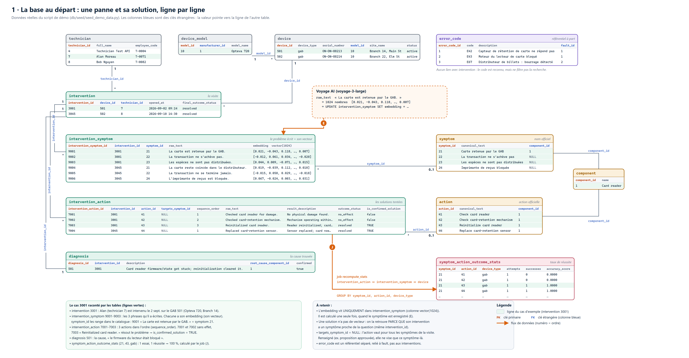
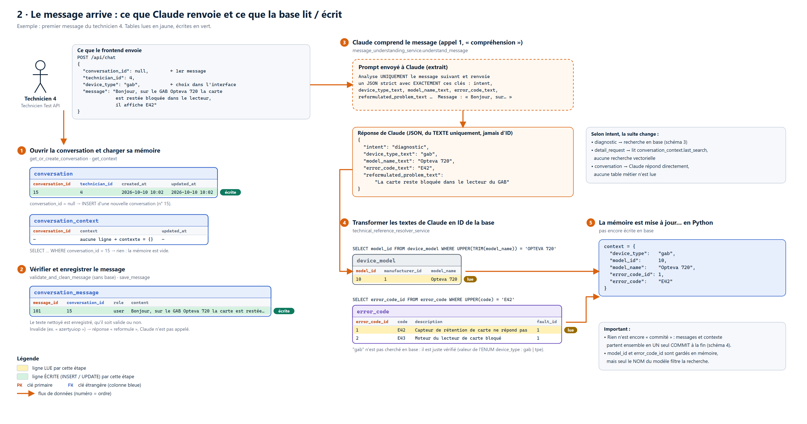
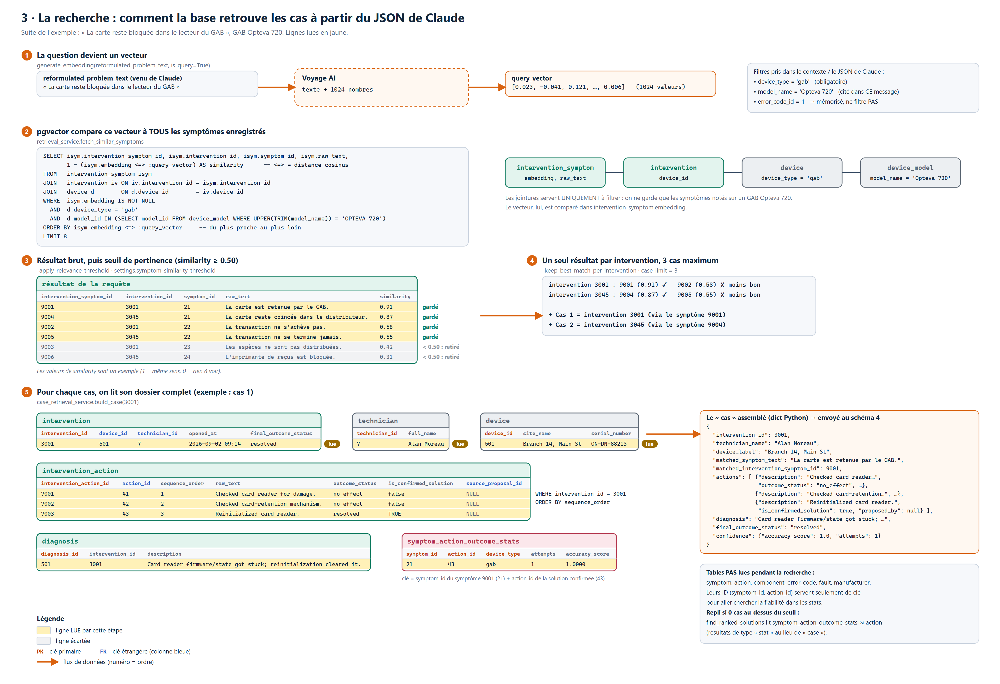
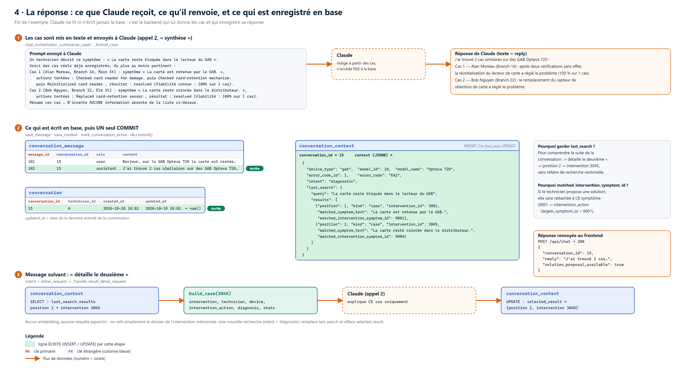

# La base de données par l'exemple

Ce document suit **un seul problème réel**, de son enregistrement en base jusqu'à la réponse du Copilote. Le but est de savoir, à chaque étape, **quelle table intervient, quelle ligne est lue ou écrite, et pourquoi**.

Les données sont celles du script de démo (`db/seed/seed_demo_data.py`). Les schémas sont dans `docs/diagrammes/` (21 à 24), avec un PNG haute définition dans `docs/diagrammes/png/`.

| Étape | Schéma | Question |
|---|---|---|
| 1 | `21-db-exemple-contenu-initial` | Comment une panne et sa solution sont-elles stockées ? |
| 2 | `22-db-exemple-comprehension` | Le message arrive : que renvoie Claude, et que fait la base ? |
| 3 | `23-db-exemple-recherche` | Comment la base retrouve-t-elle les cas ? |
| 4 | `24-db-exemple-reponse` | Que reçoit et renvoie Claude, et qu'est-ce qui est enregistré ? |

---

## 1. La base au départ : une panne et sa solution



**L'histoire :** le 2 septembre, Alan intervient sur un GAB Opteva 720 (agence Branch 14). La carte reste bloquée. Il vérifie le lecteur, puis le mécanisme de rétention, sans résultat. Il réinitialise ensuite le lecteur, et le problème est réglé.

Cette seule visite est répartie sur **6 tables** :

**`intervention`** : la visite (qui, quel appareil, quand). Elle ne contient pas de texte du problème.

| intervention_id | device_id | technician_id | opened_at | final_outcome_status |
|---|---|---|---|---|
| 3001 | 501 → `device` | 7 → `technician` | 2026-09-02 09:14 | resolved |

**`intervention_symptom`** : les phrases écrites par le technicien, **chacune avec son embedding**.

| intervention_symptom_id | intervention_id | symptom_id | raw_text | embedding vector(1024) |
|---|---|---|---|---|
| 9001 | 3001 | 21 | La carte est retenue par le GAB. | [0.021, -0.043, 0.118, …, 0.007] |
| 9002 | 3001 | 22 | La transaction ne s'achève pas. | [-0.012, 0.061, 0.034, …, -0.020] |
| 9003 | 3001 | 23 | Les espèces ne sont pas distribuées. | [0.044, 0.009, -0.071, …, 0.015] |

**`intervention_action`** : les solutions tentées, dans l'ordre.

| intervention_action_id | intervention_id | action_id | sequence_order | raw_text | outcome_status | is_confirmed_solution |
|---|---|---|---|---|---|---|
| 7001 | 3001 | 41 | 1 | Checked card reader for damage. | no_effect | false |
| 7002 | 3001 | 42 | 2 | Checked card-retention mechanism. | no_effect | false |
| 7003 | 3001 | 43 | 3 | Reinitialized card reader. | resolved | **TRUE** |

**`diagnosis`** : la cause.

| diagnosis_id | intervention_id | description |
|---|---|---|
| 501 | 3001 | Card reader firmware/state got stuck; reinitialization cleared it. |

**`symptom`** et **`action`** (le catalogue) : les noms officiels. `9001` pointe vers `symptom 21` (« Carte retenue par le GAB ») et `7003` pointe vers `action 43` (« Reinitialize card reader »).

**`symptom_action_outcome_stats`** : le taux de réussite, **calculé** par le job `recompute_stats`, jamais saisi à la main.

| symptom_id | action_id | device_type | attempts | successes | accuracy_score |
|---|---|---|---|---|---|
| 21 | 43 | gab | 1 | 1 | 1.0000 |

### Ce qu'il faut retenir
- **L'embedding n'existe que dans `intervention_symptom.embedding`** : un vecteur de 1024 nombres, calculé une seule fois par Voyage AI à partir de `raw_text`, quand le symptôme est enregistré. Deux phrases de même sens donnent des vecteurs proches.
- **Une solution n'a pas d'embedding.** On la retrouve parce qu'elle a le même `intervention_id` qu'un symptôme proche de la question.
- `targets_symptom_id = NULL` : l'action vaut pour tous les symptômes de la visite. Quand il est renseigné (par exemple pour une proposition approuvée), l'action ne vise que ce symptôme-là.
- `error_code` est un référentiel séparé, relié à `fault` et pas aux interventions.

---

## 2. Le message arrive et Claude le comprend



Le technicien 4 écrit : *« Bonjour, sur le GAB Opteva 720 la carte est restée bloquée dans le lecteur, il affiche E42 »*.

| # | Ce qui se passe | Tables | Lecture / écriture |
|---|---|---|---|
| 1 | Ouvrir la conversation | `conversation` | INSERT de la ligne 15 (premier message) |
| 1 | Charger la mémoire | `conversation_context` | SELECT : aucune ligne, donc `{}` |
| 2 | Vérifier et enregistrer le message | `conversation_message` | INSERT de la ligne 101 (`role = user`) |
| 3 | **Appel 1 à Claude** (compréhension) | aucune | — |
| 4 | Convertir les textes en ID | `device_model`, `error_code` | SELECT : `model_id = 10`, `error_code_id = 1` |
| 5 | Mettre à jour la mémoire en Python | aucune (pas encore écrite) | — |

**Ce que Claude renvoie** : du texte uniquement, jamais d'ID de la base.
```json
{
  "intent": "diagnostic",
  "device_type_text": "gab",
  "model_name_text": "Opteva 720",
  "error_code_text": "E42",
  "reformulated_problem_text": "La carte reste bloquée dans le lecteur du GAB"
}
```

**Le champ `intent` décide de la suite :**
- `diagnostic` → recherche en base (étape 3) ;
- `detail_request` → lecture de `conversation_context.last_search`, sans recherche vectorielle ;
- `conversation` → Claude répond directement, sans lire aucune table métier.

---

## 3. La recherche en base



1. **La question devient un vecteur.** Le texte `reformulated_problem_text` est envoyé à Voyage AI, qui renvoie `query_vector = [0.023, -0.041, 0.121, …]`. Ce vecteur n'est jamais stocké.
2. **pgvector compare ce vecteur à tous les symptômes** enregistrés (`retrieval_service.fetch_similar_symptoms`) :
   ```sql
   SELECT isym.intervention_symptom_id, isym.intervention_id, isym.symptom_id, isym.raw_text,
          1 - (isym.embedding <=> :query_vector) AS similarity
   FROM intervention_symptom isym
   JOIN intervention iv ON iv.intervention_id = isym.intervention_id
   JOIN device d        ON d.device_id = iv.device_id
   WHERE isym.embedding IS NOT NULL
     AND d.device_type = 'gab'
     AND d.model_id IN (SELECT model_id FROM device_model WHERE UPPER(TRIM(model_name)) = 'OPTEVA 720')
   ORDER BY isym.embedding <=> :query_vector
   LIMIT 8
   ```
   Les jointures avec `intervention`, `device` et `device_model` servent **uniquement à filtrer** (GAB, Opteva 720). La comparaison des vecteurs se fait dans `intervention_symptom`.
3. **Seuil de pertinence** : seuls les résultats avec `similarity ≥ 0.50` sont gardés. Ici, 9001 (0.91), 9004 (0.87), 9002 et 9005 sont gardés ; 9003 et 9006 sont retirés. Les scores sont un exemple.
4. **Un résultat par intervention, 3 au maximum** : 3001 est retenue via 9001 et 3045 via 9004. On obtient donc **Cas 1 = 3001** et **Cas 2 = 3045**.
5. **Lecture du dossier complet de chaque cas** (`build_case`) :
   - `intervention` ;
   - `technician` (le nom) ;
   - `device` (le site) ;
   - `intervention_action` (triée par `sequence_order`) ;
   - `diagnosis` ;
   - `symptom_action_outcome_stats`, avec la clé `(21, 43, gab)`, soit 100 % sur 1 cas.

**Tables non lues pendant la recherche :** `symptom`, `action`, `component`, `error_code`, `fault`, `manufacturer`.

**Repli :** si aucun cas ne passe le seuil, `find_ranked_solutions` lit `symptom_action_outcome_stats` et `action`, et renvoie des résultats de type « stat ».

---

## 4. La réponse et ce qui est enregistré



1. **Appel 2 à Claude (synthèse)** : les cas sont mis en texte (`_format_case`) et Claude rédige la réponse. **Claude ne lit ni n'écrit jamais la base.**
2. **Écritures, puis un seul `COMMIT`** :

| Table | Opération | Contenu |
|---|---|---|
| `conversation_message` | INSERT | ligne 102, `role = assistant`, avec la réponse de Claude |
| `conversation_context` | INSERT (1re fois) puis UPDATE | le JSON de mémoire, avec `last_search` |
| `conversation` | UPDATE | `updated_at = now()` |

Contenu de `conversation_context.context` après ce message :
```json
{
  "device_type": "gab", "model_id": 10, "model_name": "Opteva 720",
  "error_code_id": 1, "error_code": "E42", "intent": "diagnostic",
  "last_search": {
    "query": "La carte reste bloquée dans le lecteur du GAB",
    "results": [
      {"position": 1, "kind": "case", "intervention_id": 3001,
       "matched_symptom_text": "La carte est retenue par le GAB.", "matched_intervention_symptom_id": 9001},
      {"position": 2, "kind": "case", "intervention_id": 3045,
       "matched_symptom_text": "La carte reste coincée dans le distributeur.", "matched_intervention_symptom_id": 9004}
    ]
  }
}
```

3. **Message suivant, « détaille le deuxième »** :
   - Claude classe le message en `detail_request` ;
   - le backend lit `last_search.results`, trouve la position 2, donc l'intervention 3045 ;
   - `build_case(3045)` relit le dossier de cette intervention ;
   - Claude explique ce cas ;
   - le backend écrit `selected_result` dans le contexte.

   Il n'y a **aucun embedding ni aucune requête pgvector** à cette étape.

---

## Récapitulatif : quelle table intervient où

| Table | Contenu initial | Compréhension | Recherche | Réponse |
|---|---|---|---|---|
| `conversation` | | INSERT (1er msg) | | UPDATE `updated_at` |
| `conversation_message` | | INSERT (user) | | INSERT (assistant) |
| `conversation_context` | | SELECT | | INSERT / UPDATE |
| `device_model` | ✔ | SELECT (nom → ID) | filtre modèle | |
| `error_code` | ✔ | SELECT (code → ID) | | |
| `device` | ✔ | | JOIN (filtre gab) + dossier | |
| `technician` | ✔ | | dossier (nom) | |
| `intervention` | ✔ | | JOIN + dossier | |
| `intervention_symptom` | ✔ + embedding | | **recherche vectorielle** | |
| `intervention_action` | ✔ | | dossier (solutions) | |
| `diagnosis` | ✔ | | dossier (cause) | |
| `symptom_action_outcome_stats` | calculée par le job | | fiabilité | |
| `symptom`, `action`, `component` | ✔ catalogue | | (ID seulement) | |
