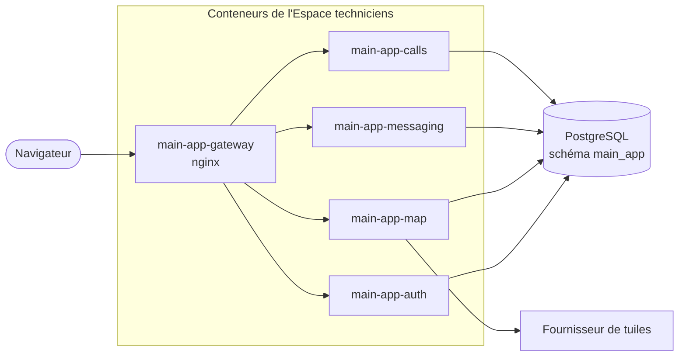

# Espace techniciens : documentation

Documentation de l'application des techniciens (dossier `main-app/`).
La référence technique détaillée (sécurité, conteneurs, variables) reste dans [`../main-app.md`](../main-app.md).

| Document | Contenu |
|---|---|
| [README.md](README.md) | Présentation, installation, démarrage |
| [base-de-donnees.md](base-de-donnees.md) | Schéma SQL, diagramme entité-association, description des tables |
| [diagrammes-uml.md](diagrammes-uml.md) | Cas d'utilisation, classes, séquences, états |
| [fonctionnement.md](fonctionnement.md) | Fonctionnement de chaque module, liste des routes de l'API |
| [../demarrage-et-connexions.md](../demarrage-et-connexions.md) | **Lancer tout le projet**, interfaces, connexion et vérification des API (avec le chatbot) |

Les diagrammes sont écrits en [Mermaid](https://mermaid.js.org/) : GitHub, GitLab et VS Code (extension *Markdown Preview Mermaid Support*) les affichent directement.

---

## 1. Présentation

L'Espace techniciens est une application web destinée aux techniciens de terrain (GAB et TPE). Elle propose quatre modules :

| Module | Rôle |
|---|---|
| **Comptes** | Connexion, gestion des comptes et des rôles par un administrateur |
| **Carte** | Carte partagée des lieux utiles : sites de GAB, clients TPE, dépôts de pièces, accès difficiles |
| **Messagerie** | Conversations entre deux techniciens : texte, photos, messages vocaux |
| **Appels** | Appels audio de navigateur à navigateur |

Elle est indépendante du chatbot de diagnostic : elle partage seulement sa base PostgreSQL, dans un schéma séparé (`main_app`).

## 2. Technologies

| Couche | Technologie |
|---|---|
| Serveur | Node.js 22, Express 5 |
| Validation | zod |
| Base de données | PostgreSQL 16 (schéma `main_app`), driver `pg` |
| Mots de passe | argon2id |
| Carte | Leaflet + MapLibre GL |
| Pièces jointes | multer, file-type, sharp |
| Appels | WebRTC (navigateur), WebSocket `ws` (serveur) |
| Interface | HTML, CSS et JavaScript natifs (sans framework) |
| Passerelle | nginx |
| Tests | Jest, Supertest |
| Déploiement | Docker Compose |

## 3. Architecture générale

Chaque module tourne dans son propre conteneur. Une passerelle nginx est le seul point d'entrée.



Si un conteneur est arrêté, seul son module est indisponible (page « service indisponible ») ; les autres continuent de fonctionner.

## 4. Installation

### Prérequis

- Docker et Docker Compose
- Un fichier `.env` à la racine du dépôt (modèle : `.env.example`)

### Variables à ajouter dans `.env`

| Variable | Exemple | Rôle |
|---|---|---|
| `MAIN_APP_DATABASE_PASSWORD` | `openssl rand -hex 24` | Mot de passe du rôle SQL de l'application |
| `MAIN_APP_MAP_TILE_URL_TEMPLATE` | `https://tile.openstreetmap.org/{z}/{x}/{y}.png` | Fournisseur des fonds de carte |
| `MAIN_APP_MAP_TILE_USER_AGENT` | `EspaceTechniciens/1.0 (contact@exemple.fr)` | Identification auprès du fournisseur |

Pour travailler en local sans HTTPS, ajouter aussi :

```env
MAIN_APP_ENVIRONMENT=development
MAIN_APP_COOKIE_SECURE=false
```

### Démarrage

Pour démarrer tout le projet en local depuis la racine :
`.\start.ps1` dans PowerShell, ou `bash start.sh` dans WSL. Le lanceur conserve
les données, prépare les paramètres manquants et le premier administrateur, puis
affiche les liens et les ports. Voir le [guide racine](../../README.md).
Ce mode est en développement HTTP ; il ne remplace pas un déploiement HTTPS
de production. Les commandes manuelles ci-dessous restent disponibles.

```bash
# Lancer le chatbot et l'Espace techniciens
docker compose -f docker-compose.yml -f docker-compose.main-app.yml up -d --build

# Créer le premier administrateur (saisie interactive)
docker compose -f docker-compose.yml -f docker-compose.main-app.yml exec main-app-auth node src/jobs/createAdmin.js
```

L'application est disponible sur <http://localhost:8080>.

Les tables sont créées automatiquement au démarrage par les migrations `db/migrations/0014` à `0018`,
puis leurs noms passent en français avec `0019` (sans modifier les comptes).

### Désactiver la connexion en développement

Pour éviter de se connecter à chaque test, ajouter dans `.env` le nom d'un compte existant :

```env
MAIN_APP_DEVELOPMENT_AUTO_LOGIN_USERNAME=alan_admin
```

Toute requête sans session agit alors en tant que ce compte. Cette option est refusée au démarrage si `MAIN_APP_ENVIRONMENT=production`.

### Commandes utiles

Préfixe : `docker compose -f docker-compose.yml -f docker-compose.main-app.yml`

| Action | Commande |
|---|---|
| Voir l'état des conteneurs | `ps` |
| Suivre les journaux d'un module | `logs -f main-app-messaging` |
| Redémarrer un module | `restart main-app-map` |
| Reconstruire un module après modification | `up -d --build --no-deps main-app-calls` |

## 5. Tests

```bash
cd main-app
npm install
npm run lint

# Tests unitaires et d'intégration, sur une base PostgreSQL jetable
sh tests/integration/runIntegrationTestsWithDisposableDatabase.sh
```

## 6. Organisation du code

```
main-app/
├── gateway/          passerelle nginx et pages communes (accueil, styles, scripts partagés)
├── web/              pages de chaque module : auth/, map/, messaging/, calls/
├── src/
│   ├── entrypoints/  un point d'entrée par conteneur
│   ├── routes/       associe chaque URL à son contrôleur
│   ├── controllers/  lit la requête et renvoie la réponse JSON
│   ├── services/     règles métier
│   ├── models/       requêtes SQL
│   ├── schemas/      validation des données reçues
│   ├── middlewares/  authentification, rôles, erreurs
│   ├── core/         configuration, base de données, sessions, journaux
│   └── jobs/         tâches ponctuelles (création d'admin, nettoyages)
└── tests/            tests unitaires et d'intégration
```

Les modules ne s'importent jamais entre eux : ils ne partagent que `core/` et `middlewares/`.
