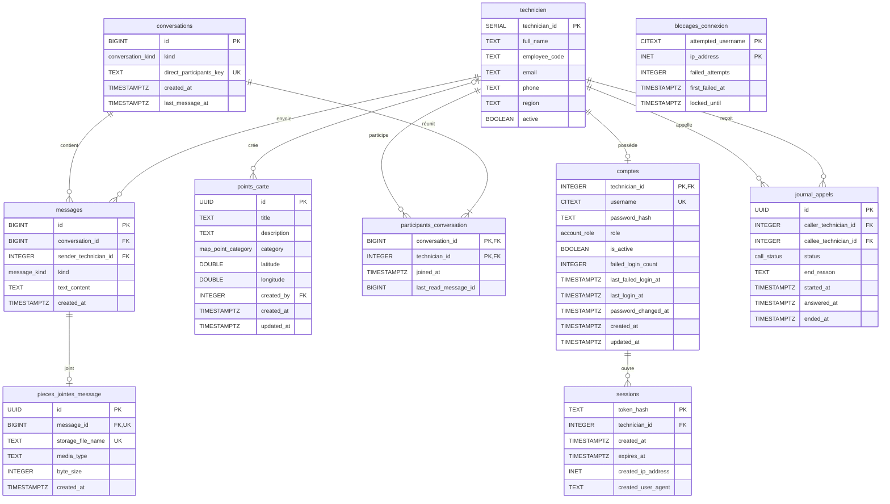

# Base de données

L'Espace techniciens utilise la base PostgreSQL du chatbot, mais toutes ses tables sont dans le schéma **`main_app`**.
La seule table du chatbot utilisée est `public.technicien` : chaque compte de l'application correspond à un technicien.

| Migration | Contenu |
|---|---|
| `0014_main_app_schema.sql` | Schéma `main_app`, extensions, type `account_role`, rôle SQL `main_app_user` |
| `0015_main_app_auth.sql` | `comptes`, `sessions`, `blocages_connexion` |
| `0016_main_app_map.sql` | `points_carte` |
| `0017_main_app_messaging.sql` | `conversations`, `participants_conversation`, `messages`, `pieces_jointes_message` |
| `0018_main_app_calls.sql` | `journal_appels` |

Les migrations se trouvent dans `db/migrations/` et sont appliquées automatiquement au démarrage (service `init-db`).

Les noms présentés ici sont ceux **après la migration 0019**. Les migrations 0014
à 0018 ci-dessus créent les noms anglais historiques, puis 0019 les renomme sans
changer les lignes, colonnes ou permissions. Voir la [correspondance complète](../tables-en-francais.md).

---

## 1. Diagramme entité-association



`technicien` appartient au chatbot (schéma `public`) et n'est jamais modifiée. L'application peut seulement y lire des lignes et en ajouter une à la création d'un compte.

---

## 2. Types énumérés

| Type | Valeurs |
|---|---|
| `account_role` | `technician`, `moderator`, `admin` |
| `map_point_category` | `atm_site` (site de GAB), `tpe_client` (client TPE), `parts_depot` (dépôt de pièces), `difficult_access` (accès difficile), `other` |
| `conversation_kind` | `direct`, `group` (réservé pour plus tard) |
| `message_kind` | `text`, `image`, `audio` |
| `call_status` | `missed`, `answered`, `declined`, `failed` |

---

## 3. Description des tables

### Module Comptes

#### `comptes` : comptes utilisateurs

| Colonne | Type | Contraintes | Description |
|---|---|---|---|
| `technician_id` | INTEGER | PK, FK → `technicien` (cascade) | Le technicien correspondant |
| `username` | CITEXT | NOT NULL, UNIQUE, 3 à 30 caractères `[a-zA-Z0-9_.-]` | Nom de connexion, insensible à la casse |
| `password_hash` | TEXT | NOT NULL | Empreinte argon2id (jamais le mot de passe) |
| `role` | account_role | défaut `technician` | Rôle de l'utilisateur |
| `is_active` | BOOLEAN | défaut `true` | Un compte désactivé ne peut plus se connecter |
| `failed_login_count` | INTEGER | ≥ 0 | Nombre d'échecs de connexion |
| `last_failed_login_at` | TIMESTAMPTZ | | Dernier échec |
| `last_login_at` | TIMESTAMPTZ | | Dernière connexion réussie |
| `password_changed_at` | TIMESTAMPTZ | | Dernier changement de mot de passe |
| `created_at`, `updated_at` | TIMESTAMPTZ | | Dates de création et de modification |

#### `sessions` : sessions ouvertes

| Colonne | Type | Contraintes | Description |
|---|---|---|---|
| `token_hash` | TEXT | PK, 64 caractères | Empreinte SHA-256 du jeton du cookie |
| `technician_id` | INTEGER | FK → `comptes` (cascade) | Propriétaire de la session |
| `created_at` | TIMESTAMPTZ | | Ouverture |
| `expires_at` | TIMESTAMPTZ | NOT NULL | Expiration (12 h par défaut) |
| `created_ip_address` | INET | | Adresse IP à l'ouverture |
| `created_user_agent` | TEXT | | Navigateur à l'ouverture |

#### `blocages_connexion` : blocage après échecs de connexion

| Colonne | Type | Contraintes | Description |
|---|---|---|---|
| `attempted_username` | CITEXT | PK | Nom saisi (existant ou non) |
| `ip_address` | INET | PK | Adresse IP de la tentative |
| `failed_attempts` | INTEGER | ≥ 0 | Nombre d'échecs |
| `first_failed_at` | TIMESTAMPTZ | | Premier échec de la série |
| `locked_until` | TIMESTAMPTZ | | Fin du blocage (15 min après 5 échecs, par défaut) |

### Module Carte

#### `points_carte` : points de la carte

| Colonne | Type | Contraintes | Description |
|---|---|---|---|
| `id` | UUID | PK | Identifiant |
| `title` | TEXT | 1 à 120 caractères | Titre |
| `description` | TEXT | 2000 caractères au plus | Description |
| `category` | map_point_category | défaut `other` | Catégorie |
| `latitude` | DOUBLE PRECISION | entre -90 et 90 | Latitude |
| `longitude` | DOUBLE PRECISION | entre -180 et 180 | Longitude |
| `created_by` | INTEGER | FK → `technicien` (mis à NULL si supprimé) | Auteur |
| `created_at`, `updated_at` | TIMESTAMPTZ | | Dates |

Index : un index GiST sur `ll_to_earth(latitude, longitude)` pour la recherche par distance, et un index sur `(latitude, longitude)` pour la recherche par zone affichée.

### Module Messagerie

#### `conversations`

| Colonne | Type | Contraintes | Description |
|---|---|---|---|
| `id` | BIGINT | PK, auto-incrémenté | Identifiant |
| `kind` | conversation_kind | défaut `direct` | Type de conversation |
| `direct_participants_key` | TEXT | UNIQUE | `"<plus petit id>:<plus grand id>"` : une seule conversation par paire |
| `created_at` | TIMESTAMPTZ | | Création |
| `last_message_at` | TIMESTAMPTZ | | Date du dernier message (tri de la liste) |

#### `participants_conversation`

| Colonne | Type | Contraintes | Description |
|---|---|---|---|
| `conversation_id` | BIGINT | PK, FK → `conversations` | Conversation |
| `technician_id` | INTEGER | PK, FK → `technicien` | Participant |
| `joined_at` | TIMESTAMPTZ | | Arrivée dans la conversation |
| `last_read_message_id` | BIGINT | défaut 0 | Dernier message lu (calcul des non-lus) |

#### `messages`

| Colonne | Type | Contraintes | Description |
|---|---|---|---|
| `id` | BIGINT | PK, auto-incrémenté | Identifiant croissant |
| `conversation_id` | BIGINT | FK → `conversations` | Conversation |
| `sender_technician_id` | INTEGER | FK → `technicien` | Expéditeur |
| `kind` | message_kind | défaut `text` | Texte, image ou audio |
| `text_content` | TEXT | 2000 caractères au plus, non vide pour un texte | Texte, ou légende de la pièce jointe |
| `created_at` | TIMESTAMPTZ | | Envoi |

#### `pieces_jointes_message`

| Colonne | Type | Contraintes | Description |
|---|---|---|---|
| `id` | UUID | PK | Identifiant |
| `message_id` | BIGINT | FK → `messages`, UNIQUE | Message (une pièce jointe par message) |
| `storage_file_name` | TEXT | UNIQUE | Nom aléatoire du fichier sur le disque |
| `media_type` | TEXT | `image/...` ou `audio/...` | Type vérifié du fichier |
| `byte_size` | INTEGER | > 0 | Taille |
| `created_at` | TIMESTAMPTZ | | Envoi |

### Module Appels

#### `journal_appels` : historique des appels

| Colonne | Type | Contraintes | Description |
|---|---|---|---|
| `id` | UUID | PK | Identifiant de l'appel |
| `caller_technician_id` | INTEGER | FK → `technicien` | Appelant |
| `callee_technician_id` | INTEGER | FK → `technicien`, différent de l'appelant | Appelé |
| `status` | call_status | NOT NULL | Résultat de l'appel |
| `end_reason` | TEXT | | Cause : `busy`, `callee_offline`, `no_answer`, `hung_up`… |
| `started_at` | TIMESTAMPTZ | NOT NULL | Début de la sonnerie |
| `answered_at` | TIMESTAMPTZ | obligatoire si `answered` | Décroché |
| `ended_at` | TIMESTAMPTZ | ≥ `started_at` | Fin |

La durée d'un appel décroché est `ended_at - answered_at`. Le son n'est jamais enregistré.

---

## 4. Rôle SQL et droits

Les conteneurs se connectent avec le rôle **`main_app_user`**, qui a des droits limités :

| Objet | Droits |
|---|---|
| Tables du schéma `main_app` | `SELECT`, `INSERT`, `UPDATE`, `DELETE` |
| `public.technicien` | `SELECT`, `INSERT` uniquement |
| Autres tables du chatbot | aucun |
| Structure (`CREATE`, `ALTER`, `DROP`) | aucun : la structure ne change que par migration |

---

## 5. Requêtes utiles

```sql
-- Comptes et rôles
SELECT a.username, a.role, a.is_active, t.full_name
FROM main_app.comptes a
JOIN public.technicien t USING (technician_id)
ORDER BY a.username;

-- Points situés à moins de 5 km d'une position
SELECT title, category,
       round(earth_distance(ll_to_earth(latitude, longitude), ll_to_earth(48.8566, 2.3522))) AS distance_metres
FROM main_app.points_carte
WHERE earth_box(ll_to_earth(48.8566, 2.3522), 5000) @> ll_to_earth(latitude, longitude)
ORDER BY distance_metres;

-- Nombre de messages non lus par conversation pour le technicien 1
SELECT p.conversation_id, count(m.id) AS non_lus
FROM main_app.participants_conversation p
JOIN main_app.messages m
  ON m.conversation_id = p.conversation_id
 AND m.id > p.last_read_message_id
 AND m.sender_technician_id <> p.technician_id
WHERE p.technician_id = 1
GROUP BY p.conversation_id;

-- Derniers appels avec leur durée
SELECT caller_technician_id, callee_technician_id, status, end_reason,
       ended_at - answered_at AS duree
FROM main_app.journal_appels
ORDER BY started_at DESC
LIMIT 20;
```
