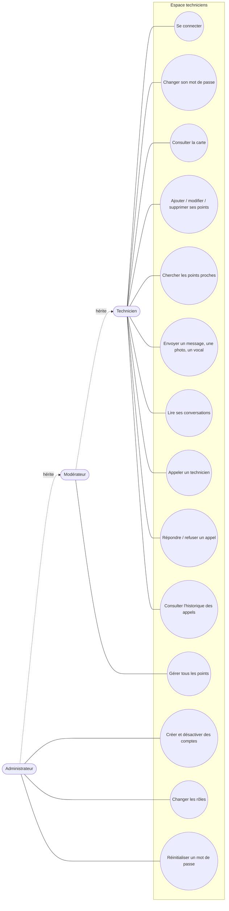
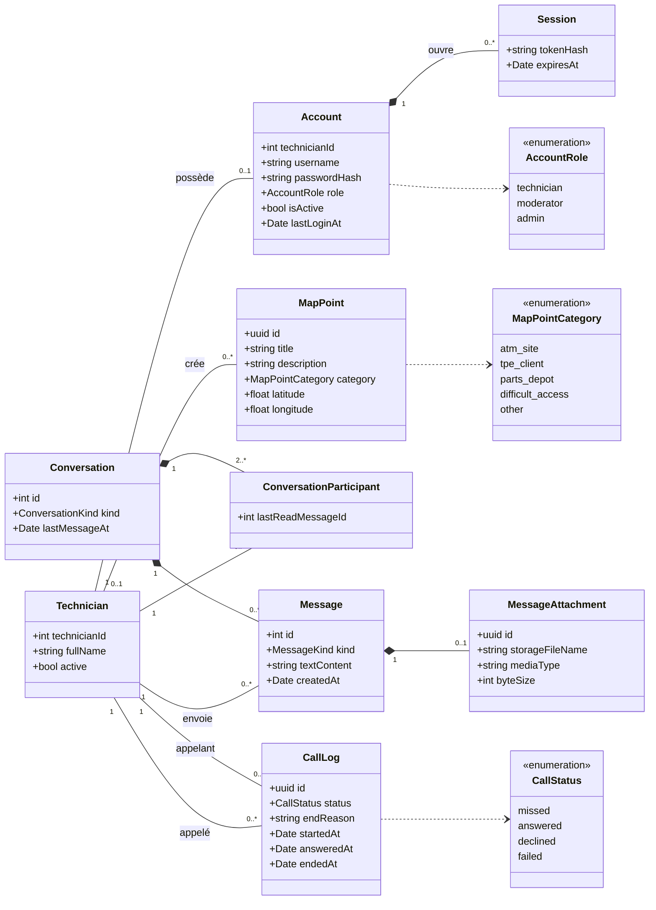
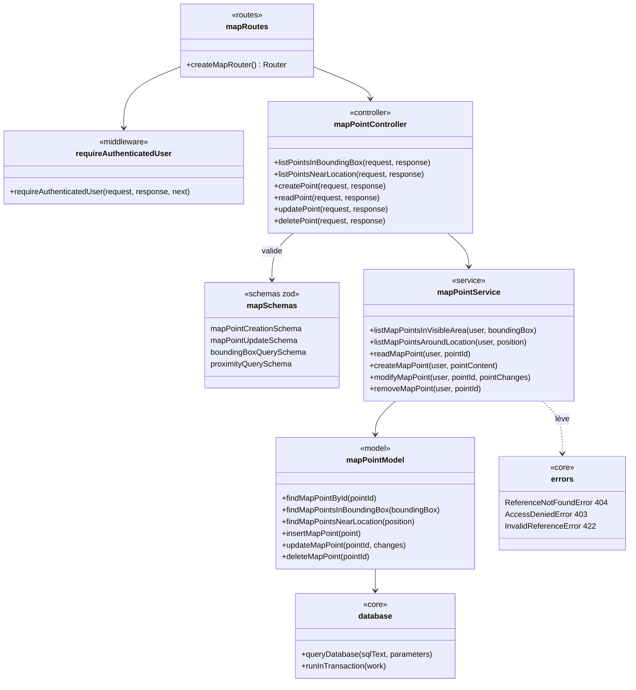
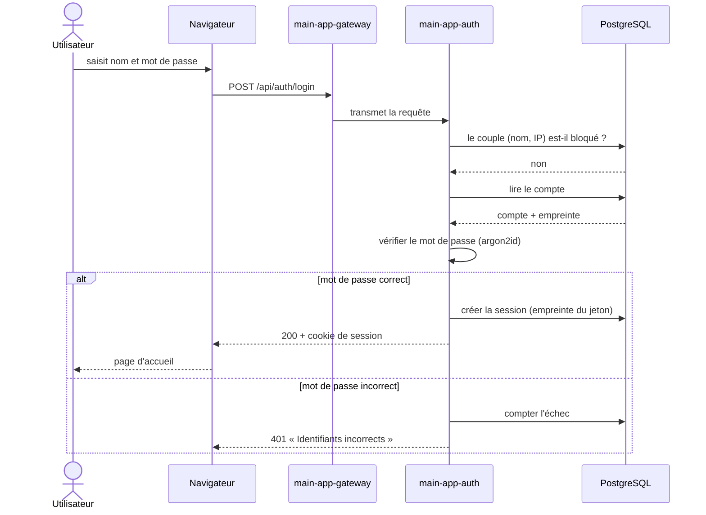
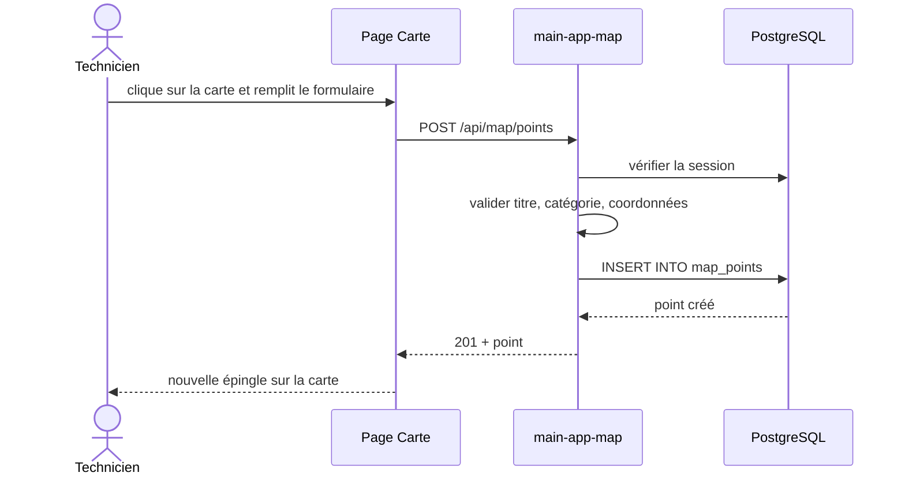
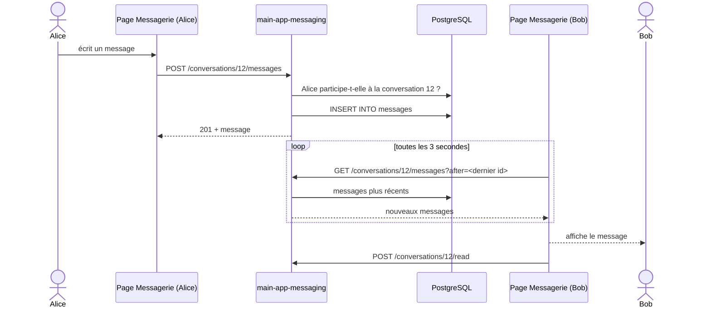
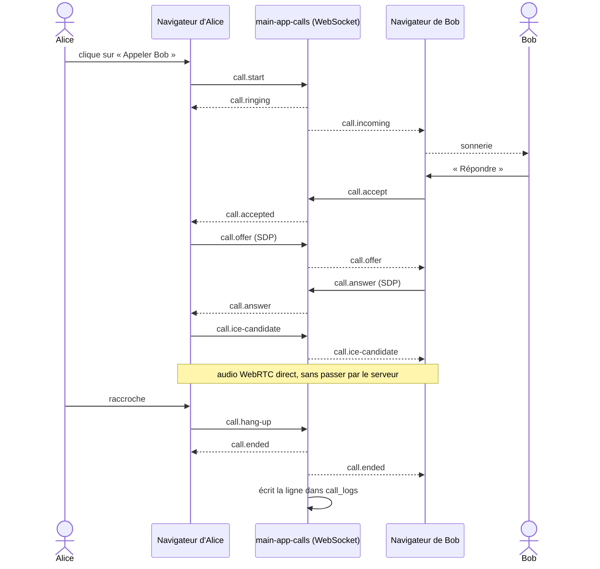
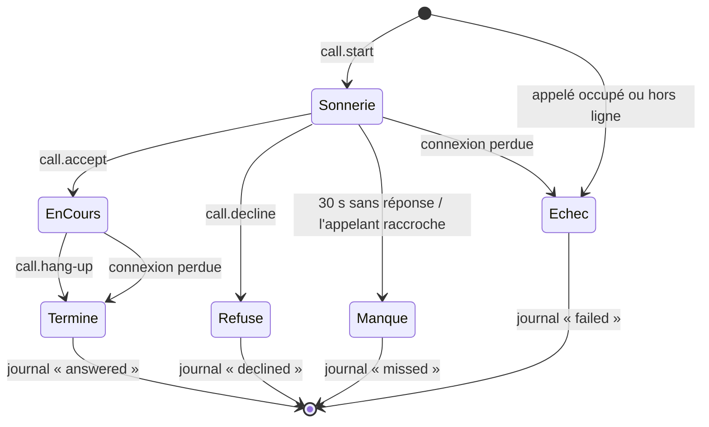
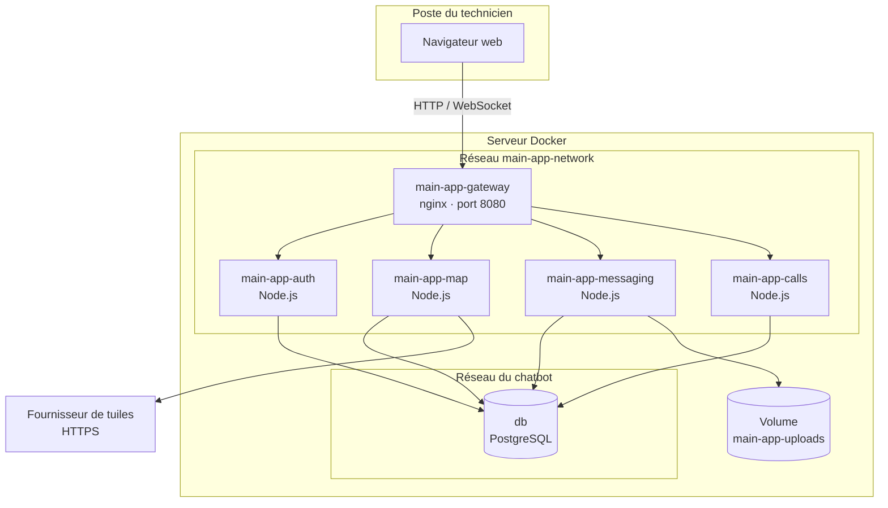

# Diagrammes UML

1. [Cas d'utilisation](#1-cas-dutilisation)
2. [Diagramme de classes du domaine](#2-diagramme-de-classes-du-domaine)
3. [Diagramme de classes du code (couches)](#3-diagramme-de-classes-du-code-couches)
4. [Diagrammes de séquence](#4-diagrammes-de-séquence)
5. [Diagramme d'états d'un appel](#5-diagramme-détats-dun-appel)
6. [Diagramme de déploiement](#6-diagramme-de-déploiement)

---

## 1. Cas d'utilisation

Trois acteurs : le **technicien**, le **modérateur** (un technicien qui gère tous les points de la carte) et l'**administrateur** (qui gère en plus les comptes). Chaque acteur hérite des droits du précédent.

---

## 2. Diagramme de classes du domaine

Les objets métier et leurs relations. Chaque classe correspond à une table du schéma `main_app` (voir [base-de-donnees.md](base-de-donnees.md)).

---

## 3. Diagramme de classes du code (couches)

Chaque module suit le même découpage. Exemple avec le module Carte ; les modules Comptes, Messagerie et Appels sont construits de la même façon.

| Couche | Responsabilité | Connaît HTTP ? | Connaît SQL ? |
|---|---|---|---|
| `routes/` | Associe une URL à ses middlewares et à son contrôleur | oui | non |
| `controllers/` | Valide l'entrée, appelle le service, renvoie le JSON | oui | non |
| `services/` | Règles métier (droits, limites, cohérence) | non | non |
| `models/` | Lit et écrit en base | non | oui |
| `schemas/` | Décrit les données attendues (zod) | non | non |

---

## 4. Diagrammes de séquence

### 4.1 Connexion

### 4.2 Ajout d'un point sur la carte

### 4.3 Envoi et réception d'un message

La réception se fait par interrogation régulière du serveur (toutes les 3 secondes).

### 4.4 Appel vocal

Le serveur ne fait que mettre les deux navigateurs en relation. Le son passe ensuite directement entre eux.

---

## 5. Diagramme d'états d'un appel

Un utilisateur ne peut avoir qu'un appel à la fois : pendant la sonnerie ou la conversation, un autre appel reçoit « occupé ».

---

## 6. Diagramme de déploiement

Les quatre conteneurs Node.js utilisent la même image ; seule la commande de démarrage change.
